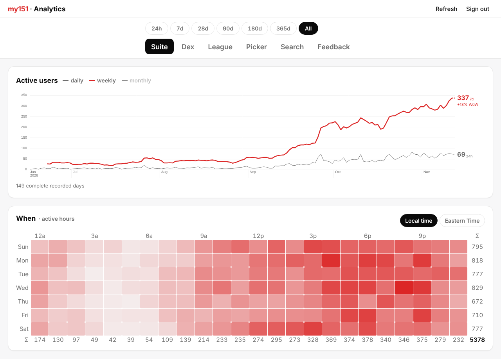
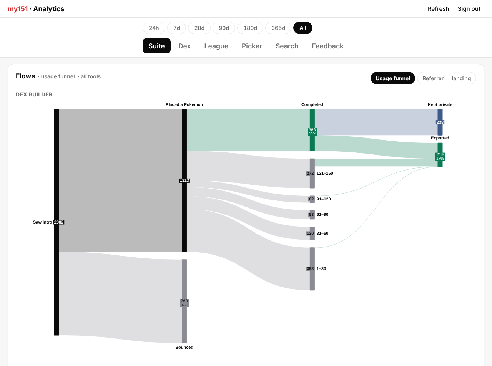
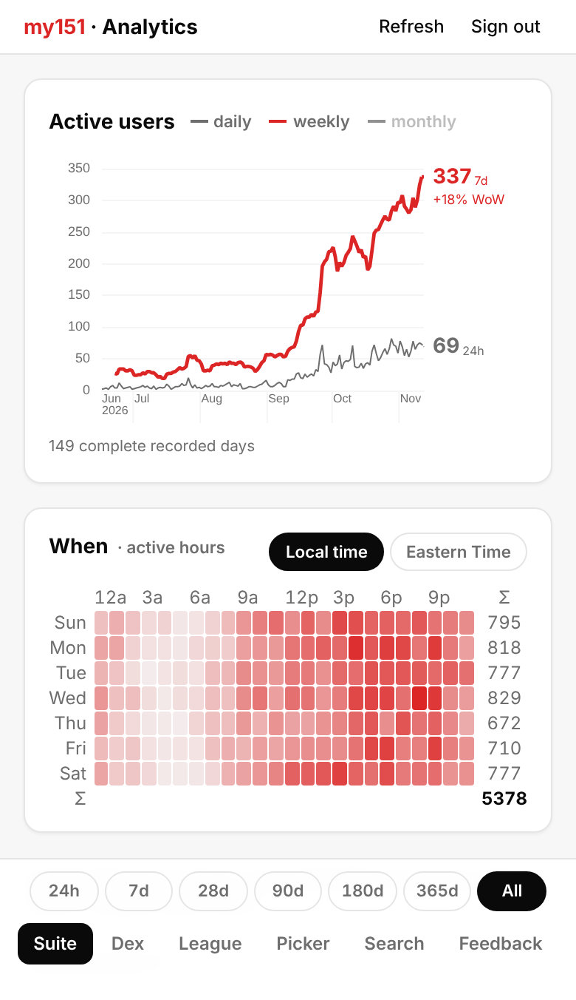

# my151

[my151.app](https://my151.app) is a set of free browser tools for Pokémon fans.
You can fill your own regional Pokédex, design a Pokémon League of gym leaders, and pick a favorite Pokémon for each type and generation.
The tools need no account, and each one exports a PNG image that you can share.

## Tools

| Tool | Purpose |
| --- | --- |
| [Dex Builder](https://my151.app/pokedex-builder) | Fill a 151-slot regional Pokédex from templates of roles such as starters, regional bug, and cave. Compare its type distribution with the National Dex, then export a poster. |
| [League Builder](https://my151.app/custom-gym-leader) | Make gym leader trainer cards with an ace, a partner, a TM, a badge, and a team that changes with each badge. Add an Elite Four, a Champion, and an endgame boss. |
| [Favorite Picker](https://my151.app/favorite-pokemon-picker) | Pick a favorite Pokémon for each type in each generation, then see statistics on the kinds of Pokémon you prefer. |

## Screenshots

The screenshots show sample data in a local production build: the built-in 151-Pokémon demo, a Kanto League fixture, and a filled picker grid.

The Dex Builder on a desktop screen, 1280 pixels wide:


The League Builder with the league list and the trainer card for its first gym leader:


The Favorite Picker with a filled grid of types by generation:


The same three tools on a phone screen, 390 pixels wide:


## Capabilities

- **Nine interface languages.** The app supports English, Japanese, Korean, Simplified Chinese, Traditional Chinese, French, German, Spanish, and Italian ([`src/i18n/config.ts`](src/i18n/config.ts)). Pokémon names, types, and other game terms come from the games' own text, and app copy without a reviewed translation falls back to English.
- **PNG export.** Each tool draws its export on a canvas and saves a PNG file. On iPhone and iPad, the export opens the share sheet. On other devices, it downloads.
- **Saved on your device.** Each tool keeps its state in the browser's local storage, so you need no account or sign-in. Saved-data migrations keep your selections when the data format changes. A service worker stores sprites in IndexedDB, so later visits load them from the device.
- **Admin analytics dashboard.** An authenticated dashboard at `/?admin` reports usage from records that the app's own Vercel functions store in Upstash Redis. See [Admin analytics dashboard](#admin-analytics-dashboard).
- **Performance budgets.** [`scripts/check-bundle-budget.mjs`](scripts/check-bundle-budget.mjs) fails a change that grows the first-load download of the home page, the Dex Builder, or the League Builder by more than 5% over its baseline. [Performance](docs/performance.md) sets field targets for Largest Contentful Paint (LCP), Interaction to Next Paint (INP), and Cumulative Layout Shift (CLS).
- **Cross-engine verification.** The [verify-my151 harness](.claude/skills/verify-my151/SKILL.md) drives the built app in Blink, WebKit, and Gecko, the engines behind desktop and Android Chrome, iOS Safari and Chrome, and desktop Firefox. For a change, it compares screenshots of the old and new builds at 390 and 1280 pixels wide.

## Admin analytics dashboard

The dashboard at `/?admin` needs a token.
It counts browsers, not people: each browser keeps a random ID in local storage.
It shows these measures:

- Active browsers by day, with weekly and monthly lines and the change from week to week.
- Active hours by weekday, in the viewer's local time or in Eastern Time.
- The browsers that use more than one tool.
- A funnel for each tool, from the first visit to a finished build and an export, and the path from each referrer to its landing page.
- Device, operating system, browser, region, country, and language. Each tool also has its own tab with what people pick, and further tabs show search performance from Google Search Console and feedback reports.

The server stores no usage records from these browsers:

- **Automated browsers.** Playwright, Puppeteer, Selenium, and other WebDriver clients set `navigator.webdriver`. The app marks their requests, and the server stores nothing for them.
- **The owner's browsers.** Open any page with `?notme` once, and the server stores no usage records from that browser. Open a page with `?countme` to count it again.

Requests to a deploy URL other than my151.app store nothing either.
[Analytics accuracy](docs/analytics-accuracy.md) explains how the dashboard's counts differ from Vercel Web Analytics.

The screenshots show sample data.
`/?admin&demo` renders the dashboard from the synthetic fixtures in [`src/components/admin/__fixtures__/`](src/components/admin/__fixtures__), with no token and no API call.



*Sample data. The Suite tab on a desktop screen, 1280 pixels wide.*



*Sample data. The Dex Builder funnel in the Flows panel.*



*Sample data. The Suite tab on a phone screen, 390 pixels wide.*

## How it's built

- The frontend uses React 19, TypeScript, Vite 8, Tailwind CSS 4, and Zustand stores. Each tool is a separate Vite entry page.
- Vercel hosts the site. Serverless functions in [`api/`](api) collect usage records and serve the admin reports.
- One local CI runner selects checks by the changed files. It runs lint, Vitest unit tests, the translation gate, type checks, repository guards, a production build with its bundle budgets, and Playwright browser journeys.
- Visual and platform changes also need before-and-after evidence from the verify-my151 harness.

For details, see [Architecture](docs/architecture.md), [Performance](docs/performance.md), and the [documentation index](docs/README.md).

## Start development

Use a Node.js version supported by Vite 8, such as Node.js 24.
Use npm with the committed lockfile.
The browser tools run without production credentials.

```bash
npm ci
npm run dev
```

Open the Vite URL and select a tool.
Vite does not run the Vercel functions in `api/`.
Authenticated admin reports need the configured backend.
The browser suite uses API fixtures.

The public copy of this repository leaves out the Pokémon sprites in `public/sprites/pokemon/` for licensing reasons.
Without them, `npm run build` passes with a warning, and the tools show empty sprite slots.
Run `npm run cache-sprites` to download the PokeAPI sprites that `src/data/pokemon.json` names.
After that, the Pokédex builder shows almost every sprite.
Most forms in the League Builder and the Favorite Picker, such as Mega and Gigantamax forms, and most shiny sprites stay empty.

## Verify a change

```bash
npm run ci:fast
```

For the final candidate, run `npm run ci:affected -- --base REF` with the intended production base.
Use `npm run ci:full` for broad release risk.
[Build Verification in CLAUDE.md](CLAUDE.md#build-verification) owns check selection, exceptions, receipts, and deployment requirements.
[AGENTS.md](AGENTS.md) has the repository's test rules.

## License

The code in this repository is not licensed for reuse. All rights reserved. Third-party assets and dependencies are credited in [THIRD_PARTY_NOTICES.md](THIRD_PARTY_NOTICES.md).
