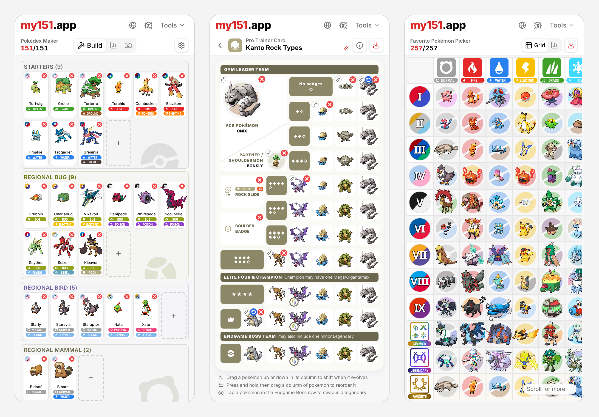
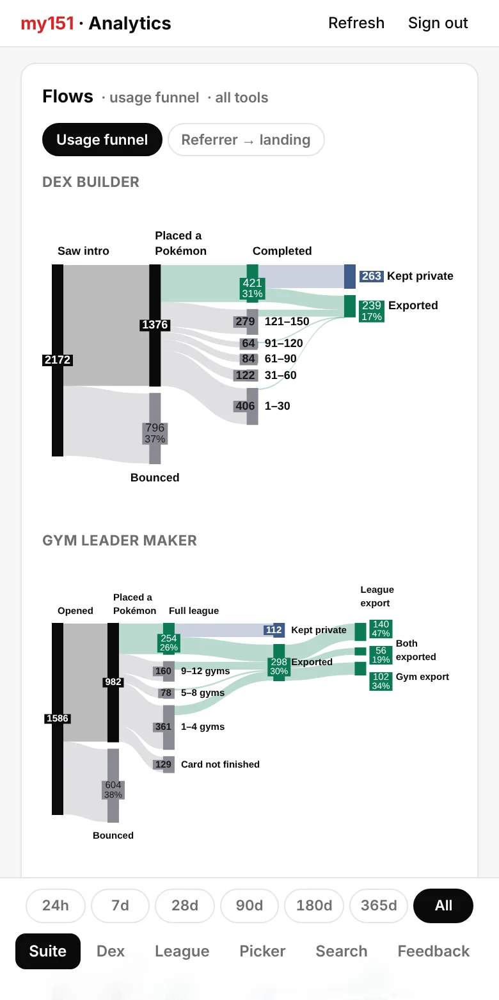
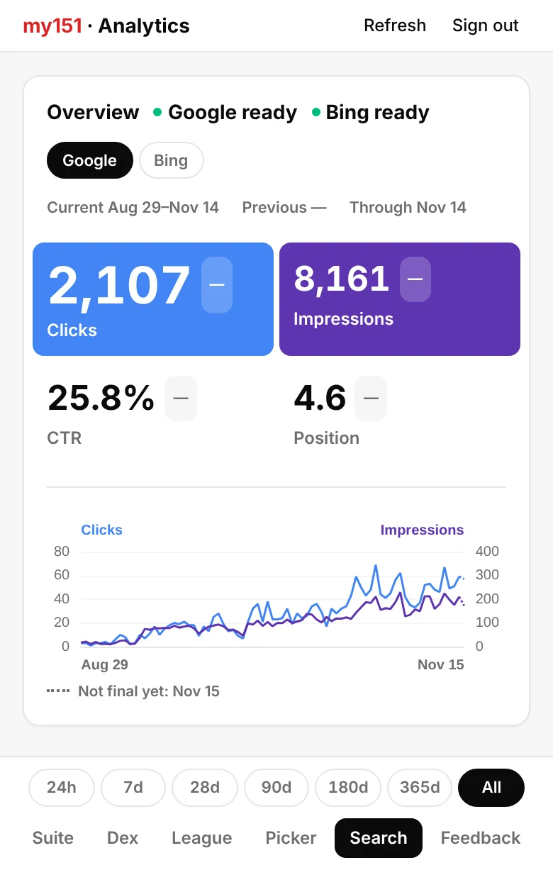
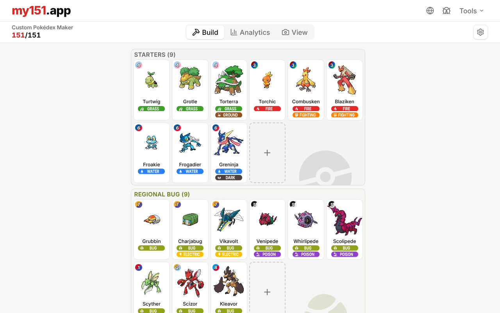
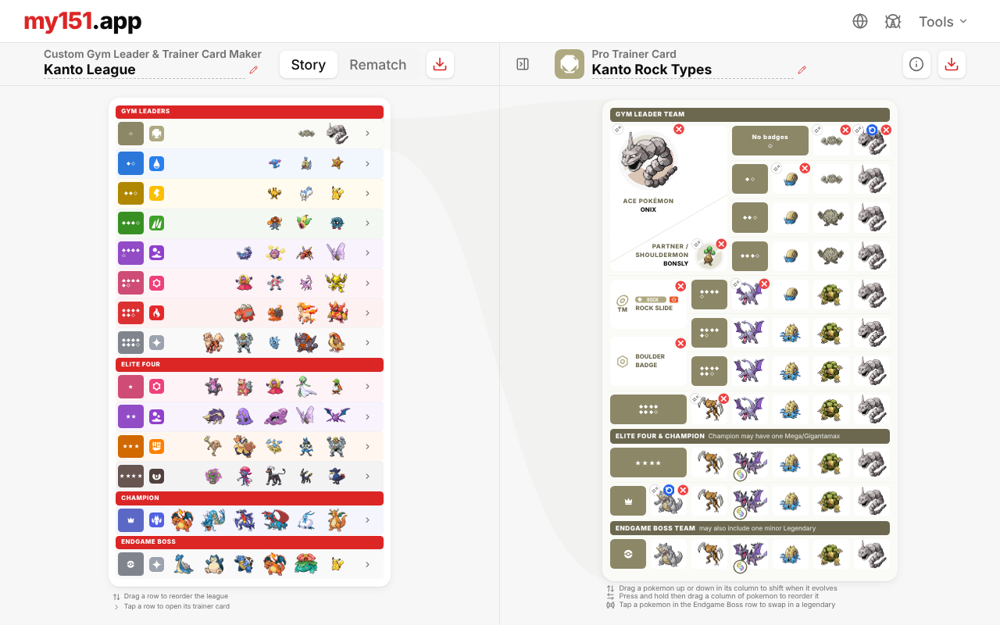
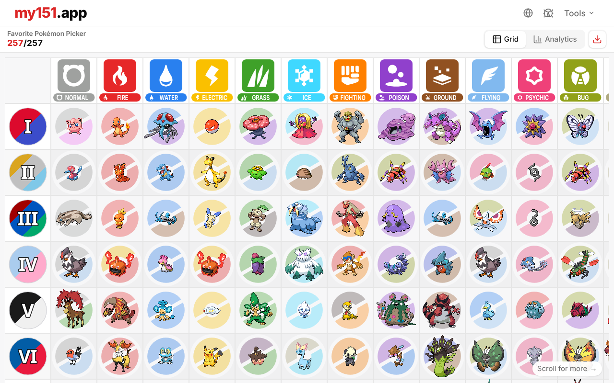

# my151

[](https://github.com/michael-samoilov/my151-public/actions/workflows/public-ci.yml)

[my151.app](https://my151.app) is a set of free browser tools for Pokémon fans.
You can fill your own regional Pokédex, design a Pokémon League of gym leaders, and pick a favorite Pokémon for each type and generation.
The tools need no account, and each one exports a PNG image that you can share.



*The three tools on a phone screen, 390 pixels wide, with sample data.*

**Status:** Live, maintained solo; not accepting contributions.

## Tools

| Tool | Purpose |
| --- | --- |
| [Dex Builder](https://my151.app/pokedex-builder) | Fill a 151-slot regional Pokédex from templates of roles such as starters, regional bug, and cave. Compare its type distribution with the National Dex, then export a poster. |
| [League Builder](https://my151.app/custom-gym-leader) | Make gym leader trainer cards with an ace, a partner, a TM, a badge, and a team that changes with each badge. Add an Elite Four, a Champion, and an endgame boss. |
| [Favorite Picker](https://my151.app/favorite-pokemon-picker) | Pick a favorite Pokémon for each type in each generation, then see statistics on the kinds of Pokémon you prefer. |

## Admin analytics dashboard

The dashboard at `/?admin` needs a token.
It counts each browser as one user: each browser keeps a random ID in local storage.
It shows these measures:

- Active users by day, with weekly and monthly lines and the change from week to week.
- Active hours by weekday, in the viewer's local time or in Eastern Time.
- The browsers that use more than one tool.
- A funnel for each tool, from the first visit to a finished build and an export, and the path from each referrer to its landing page.
- Device, operating system, browser, region, country, and language. Each tool also has its own tab with what people pick, and further tabs show search performance from Google Search Console and feedback reports.

The server stores no usage records from these browsers:

- **Automated browsers.** Playwright, Puppeteer, Selenium, and other WebDriver clients set `navigator.webdriver`. The app marks their requests, and the server stores nothing for them.
- **The owner's browsers.** Open any page with `?notme` once, and the server stores no usage records from that browser. Open a page with `?countme` to count it again.

Requests to a deploy URL other than my151.app store nothing either.
The dashboard's counts differ from Vercel Web Analytics, which counts daily unique visitors by a rotating hash instead of a stored browser ID.

The screenshots show live data for all time, captured on a phone screen on November 16, 2026.
`/?admin&demo` renders the dashboard from the synthetic fixtures in [`src/components/admin/__fixtures__/`](src/components/admin/__fixtures__), with no token and no admin API call.

<p>
  
  
  
</p>

*Live data, November 16, 2026, on a phone screen 390 pixels wide: the Suite tab, the usage funnels in the Flows panel, and the Search tab. The Search tab's keyword and page tables are hidden.*

## Start here

These files show how the project works:

- [`api/_aggregate.ts`](api/_aggregate.ts) and [`api/_dashboard.ts`](api/_dashboard.ts): the analytics pipeline. They turn the stored usage records into the admin reports.
- [`src/components/admin/`](src/components/admin): the admin dashboard. Run `npm run dev` and open `/?admin&demo` to see it with synthetic data.
- [`scripts/ci/policy.ts`](scripts/ci/policy.ts): the CI selection. It picks the checks and browser specs that a change needs.
- [`scripts/eslint/writtenRules.mjs`](scripts/eslint/writtenRules.mjs): repository rules as ESLint checks. Each error names the rule, its source, and the fix.
- [`docs/performance.md`](docs/performance.md): the speed targets, the measurements, and the ideas that were tried and left out.

## Screenshots

The screenshots show sample data in a local production build: the built-in 151-Pokémon demo, a Kanto League fixture, and a filled picker grid.

The Dex Builder on a desktop screen, 1280 pixels wide:



The League Builder with the league list and the trainer card for its first gym leader:



The Favorite Picker with a filled grid of types by generation:



## Capabilities

- **Nine interface languages.** The app supports English, Japanese, Korean, Simplified Chinese, Traditional Chinese, French, German, Spanish, and Italian ([`src/i18n/config.ts`](src/i18n/config.ts)). Pokémon names, types, and other game terms come from the games' own text, and app copy without a reviewed translation falls back to English.
- **PNG export.** Each tool draws its export on a canvas and saves a PNG file. On iPhone and iPad, the export opens the share sheet. On other devices, it downloads.
- **Saved on your device.** Each tool keeps its state in the browser's local storage, so you need no account or sign-in. Saved-data migrations keep your selections when the data format changes. A service worker stores sprites in IndexedDB, so later visits load them from the device.
- **Admin analytics dashboard.** An authenticated dashboard at `/?admin` reports usage from records that the app's own Vercel functions store in Upstash Redis. See [Admin analytics dashboard](#admin-analytics-dashboard).
- **Performance budgets.** [`scripts/check-bundle-budget.mjs`](scripts/check-bundle-budget.mjs) fails a change that grows the first-load download of the home page, the Dex Builder, or the League Builder by more than 5% over its baseline. [Performance](docs/performance.md) sets field targets for Largest Contentful Paint (LCP), Interaction to Next Paint (INP), and Cumulative Layout Shift (CLS).
- **Cross-engine verification.** The [verify-my151 harness](.claude/skills/verify-my151/SKILL.md) drives the built app in Blink, WebKit, and Gecko, the engines behind desktop and Android Chrome, iOS Safari and Chrome, and desktop Firefox. For a change, it compares screenshots of the old and new builds at 390 and 1280 pixels wide.

## How it's built

- The frontend uses React 19, TypeScript, Vite 8, Tailwind CSS 4, and Zustand stores. Each tool is a separate Vite entry page.
- Vercel hosts the site. Serverless functions in [`api/`](api) collect usage records and serve the admin reports.
- One local CI runner selects checks by the changed files. It runs lint, Vitest unit tests, the translation gate, type checks, repository guards, a production build with its bundle budgets, and Playwright browser journeys.
- Visual and platform changes also need before-and-after evidence from the verify-my151 harness.

For details, see [Architecture](docs/architecture.md), [Performance](docs/performance.md), and the [documentation index](docs/README.md).

## Start development

Use Node.js 22 (22.18 or later) or 24, as the `engines` field in `package.json` sets.
Use npm with the committed lockfile.
The browser tools run without production credentials.

```bash
npm ci
npm run dev
```

Open the Vite URL and select a tool.
Vite does not run the Vercel functions in `api/`.
Authenticated admin reports need the configured backend.
[`.env.example`](.env.example) lists every variable that the functions and tools read.
The browser suite uses API fixtures.
The Pokémon sprites are fan art and game assets with their own credits. See [THIRD_PARTY_NOTICES.md](THIRD_PARTY_NOTICES.md).

## Verify a change

```bash
npm run ci:fast
```

For the final candidate, run `npm run ci:affected -- --base REF` with the intended production base.
Without a `--base`, the runner compares with the production branch, or with `origin/main` in a clone that does not have it.
The full browser suite (about 1,000 tests, about 30 minutes) runs in the background after each release, and a release that breaks it is rolled back. Before a merge, a change runs the specs that the test map selects.
[Build Verification in CLAUDE.md](CLAUDE.md#build-verification) owns check selection, exceptions, receipts, and deployment requirements.
[AGENTS.md](AGENTS.md) has the repository's test rules.
`npm run ci:fast` runs Playwright browser journeys, so install a browser first with `npx playwright install chromium`.

## Known limits

- **Large files.** Six files in `src/` have more than 1,000 lines. The two largest, [`src/components/admin/AdminPage.tsx`](src/components/admin/AdminPage.tsx) (about 2,300 lines) and [`src/league/components/CardGrid.tsx`](src/league/components/CardGrid.tsx) (about 2,000), each hold more than one concern.
- **One browser per save.** Each tool saves to one browser's local storage. There is no sync or backup, so a cleared browser or a new device starts empty.
- **No local API.** Vite does not run the functions in `api/`. The admin reports need an Upstash Redis database and an admin token, or the synthetic data at `/?admin&demo`.
- **One user per browser.** The dashboard counts a user for each browser ID, so one person on two devices counts as two users.
- **Unverified counts.** The dashboard counts come from unauthenticated beacons, rate-limited per network. They are not verified identities.

## About this repository

This repository is the read-only public copy of a private working repository, updated weekly.
Branch names in `CLAUDE.md` and `AGENTS.md` refer to the private repository.
Commit IDs cited in the docs refer to the private working repository.
AI coding agents (Claude Code, Codex, and Cursor) wrote the code under my direction.
They work in small steps on separate branches, so about a quarter of the commits are merges.
The repository's rules require its checks to pass before each merge to production: see [`AGENTS.md`](AGENTS.md), [`CLAUDE.md`](CLAUDE.md), and [`scripts/ci/policy.ts`](scripts/ci/policy.ts).
Commits name the agent where the record shows which one wrote them.
About 400 commits name no agent: about 90 are merges made on GitHub, and for the rest no record shows which agent wrote them.
The [`.claude/`](.claude/README.md) folder holds the agents' instructions and tools.

## License

Copyright (c) 2026 Michael Samoilov. All rights reserved. See [LICENSE](LICENSE).
The code is published for reading, not for reuse.
Pokémon © 1995–2026 Nintendo / Creatures / GAME FREAK / The Pokémon Company.
Pokémon and Pokémon character names are trademarks of Nintendo.
my151 is not affiliated with or endorsed by Nintendo.
Third-party assets and dependencies are credited in [THIRD_PARTY_NOTICES.md](THIRD_PARTY_NOTICES.md).
To report a vulnerability, see [SECURITY.md](SECURITY.md).
