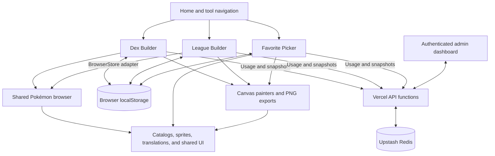

# Architecture

my151 is a React and TypeScript application with separate Vite entry points for its tools.
Most editing happens in the browser.
Vercel functions collect usage records and provide authenticated admin reports.

## Code ownership

| Area | Main code | Responsibility |
| --- | --- | --- |
| Home | [`src/home`](../src/home), [`src/components/home`](../src/components/home) | Tool navigation and the admin entry through `?admin`. |
| Dex | [`src/App.tsx`](../src/App.tsx), [`src/components`](../src/components), [`src/store`](../src/store) | Regional sections, browser, statistics, and poster view. |
| League | [`src/league`](../src/league) | Trainer cards, team rules, progression, and card exports. |
| Favorites | [`src/favorites`](../src/favorites) | Selector eligibility, choices, statistics, and charts. |
| Shared data | [`src/data`](../src/data), [`src/i18n`](../src/i18n), [`src/lib`](../src/lib) | Catalogs, language, sprite URLs, rendering, and common behavior. |
| Server and admin | [`api`](../api), [`src/components/admin`](../src/components/admin) | Record validation, storage, aggregation, and reports. |

[`vite.config.ts`](../vite.config.ts) defines the entry points and build plugins.
[`vercel.json`](../vercel.json) defines hosting behavior and legacy route redirects.
Diagnostic entry points are separate from the public tools.

## State and cross-tool connections

Each tool has a persisted Zustand store.
The stores are [`usePokedexStore`](../src/store/usePokedexStore.ts), [`useLeagueStore`](../src/league/store/useLeagueStore.ts), and [`useFavoritesStore`](../src/favorites/store/useFavoritesStore.ts).
Saved-data migrations preserve selections across schema changes.
Separate UI state holds temporary selections, open sheets, and filters where appropriate.
Browser storage provides same-browser persistence, without normal cross-device editing synchronization.
Redis stores usage records and snapshots for reports rather than the editor's primary save.

The tools also share specific state connections:

- Dex and League use the same [`PokemonBrowser`](../src/components/browser/PokemonBrowser.tsx). The [`browser contract`](../src/components/browser/browserStore.ts) accepts League's [`adapter`](../src/league/store/browserBridge.ts).
- League's adapter reads Dex selections for the My Dex filter.
- The browser's [`Favorite Picker bridge`](../src/components/browser/favoritePickerBridge.ts) reads saved favorites and maps their IDs into browser IDs.
- All public entry points initialize language from the preference in the Dex store.

The browser context accepts a read-only Zustand contract.
TypeScript checks its required state and actions without an unchecked adapter cast.
ESLint rejects direct static imports of Node built-ins, server infrastructure, and API endpoints from production browser code.
Erased types and pure API helpers remain allowed.
This rule does not inspect dynamic or transitive imports.

These connections make browser, catalog, and saved-state changes affect more than one tool.
The [surface handoffs](README.md#make-a-change) preserve the standing product decisions for each owner.

## Exports and verification

PNG exports use Canvas painters rather than screenshots of the page.
Dex uses [`src/lib/exportImage.ts`](../src/lib/exportImage.ts), League uses [`src/league/export`](../src/league/export), and Favorites uses [`src/favorites/export`](../src/favorites/export).
Painters share selected statistics, labels, and geometry with the live UI.
Page and export rendering still need separate verification.

The [`CI runner`](../scripts/ci/run.ts) selects browser specs through [`policy.ts`](../scripts/ci/policy.ts) and the [test map](../scripts/ci/test-map.json), which records the source files each spec runs.
Browser tests use API fixtures, so server logic and saved-data migrations also have direct checks.
The [build policy](../CLAUDE.md#build-verification) defines final gates and the required evidence for changed behavior.
Historical captures follow [evidence retention](evidence-retention.md), separate from application assets and regression fixtures.
