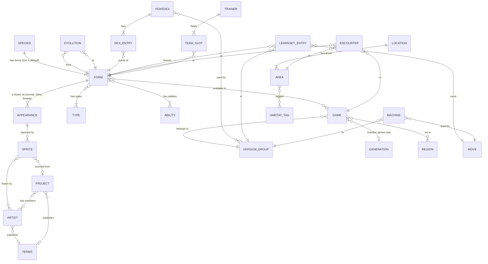

# Pokémon data model (ontology) spec

Status: proposal, for Michael's review. Nothing in this spec is built yet.
Date: 2026-11-01.

## Summary

The app knows about Pokémon in three separate catalogs, with six ID schemes and more than 50 hard-coded exception lists. This spec proposes one connected data model: species, forms, appearances, sprites, artists, games, moves, evolutions, and encounters, each an object with a stable ID and typed links. Every tool reads it through generated projections.

The first visible change it enables is sprite alignment. Today every sprite is roughly centered in its 96×96 canvas. A small grounded sprite such as Bulbasaur has 33 empty rows under its feet. With a `pose` and measured `bounds` on each sprite, grounded sprites sit on the floor of their box, and floating sprites keep the artist's placement.

The work splits into seven phases. Phase 0 (sprite pose and bounds) stands alone and ships first. Phases 1 and 2 replace the three catalogs with one, and remove the cause of most current data bugs. Moves and encounters come after that.

## Why now

- **The same ID means two Pokémon.** ID `10179` is Galarian Stunfisk in the Dex and League, and Galarian Yamask in the Favorite Picker.
- **Facts disagree between copies.** Stereo Rotom is a spin-off form in one file and a temporary battle form in another. `formBst.json[10179]` is 303, and `pokemon.json[10179].bst` is 471.
- **Nothing can rebuild the catalog.** No script reproduces `src/data/pokemon.json`. Two of the old generators erase every form if someone runs them.
- **A new form is expensive.** One form needs hand entries in several files: the Picker form list, power-up forms, League forms, name catalogs, and sprite tables. The Mega form of a regional or cosmetic form is written in four places today.
- **Sprite pose needs a home.** A pose belongs to a drawing, not a species. The current data has no place for a per-drawing fact.

## Current state

This section records what the code does on 2026-11-01. Each claim cites the file that shows it.

### Three catalogs for one set of Pokémon

| Catalog | Rows | Key | Built from |
| --- | ---: | --- | --- |
| Dex catalog, `src/data/pokemon.json` | 1,089: 1,025 species and 64 forms | Dex app ID | Hand-typed Python tuples, then several partial refresh scripts and hand edits |
| Favorite Picker catalog, `src/favorites/model/catalog.ts` | 1,427: 1,296 Dex-derived and 131 power-up forms | Picker ID | The Dex catalog, about 200 hand-written forms in `alternateForms.ts`, and `powerupForms.json` |
| League catalog, `src/league/data/catalog.ts` | 1,210: the Dex rows plus 121 forms | Dex app ID | The Dex catalog plus `src/league/data/alternateForms.json`, generated from the Picker forms |

The Dex catalog has no Mega, Gigantamax, or battle forms. Those exist only in the Picker and League form lists. The Dex catalog also has no species ID field. The form-to-species link lives in `src/i18n/alt-form-species.json` and `scripts/i18n/pokemon-id-map.json`.

### Six ID schemes, and one ID that means two Pokémon

The app uses Dex app IDs, Picker IDs, PokeAPI `pokemon` IDs, PokeAPI `pokemon_forms` IDs, name keys such as `picker:10227`, and sprite file names such as `alcremie-star`.

The schemes collide. ID `10179` is Galarian Stunfisk in the Dex and League, and Galarian Yamask in the Picker. `src/favorites/model/catalog.ts:80` translates between them by hand. `formBst.json[10179]` is 303, while `pokemon.json[10179].bst` is 471. Dex IDs `10254` to `10259` are app-minted Alcremie IDs, and PokeAPI uses the same numbers for six other Pokémon.

Saved data and the API store these IDs. `/api/submit` accepts exactly the IDs in `api/_chains.ts`. Any change of identity needs a saved-data migration.

### No reproducible build

No catalog script runs in `npm run build`, and none can rebuild the Dex catalog today.

- `scripts/combine_data.py` and `pokemon_gen1.py` to `pokemon_gen9.py` made the first file. They now differ from it in 12 stat sets, 23 capture rates, 68 growth rates, and 35 chain IDs. Running them erases every form and correction.
- `scripts/build-pokemon-data.ts` and `scripts/generate-data.cjs` read PokeAPI `master`, write default forms only, and drop shape, color, and egg groups. Running either one is destructive.
- `scripts/add-color-egg.mjs`, `add-shapes.mjs`, `sync-baby.mjs`, and `build-favorite-form-metadata.py --write` each patch some fields in place.
- No script writes the Alcremie or Urshifu rows.

### The same fact in several files

| Fact | Copies |
| --- | --- |
| Base stats and BST | `pokemon.json`, `formBst.json` (two scripts write it), `formMetadata.json`, League `alternateForms.json`, the audit `inventory.json` |
| Shape | `pokemon.json`, `src/data/form-shapes.json` applied at runtime, the shape `review.json` |
| Form to species | `alt-form-species.json`, `pokemon-id-map.json`, `api/_favoriteSpecies.json`, `favoriteBrowserIds.json`, League `powerupSpecies` |
| Spin-off status | `FORM_SOURCES` in `sourceGame.ts`, `LATER_DEBUTS` in `debut.ts`, `PICKER_ONLY_FORM_IDS` in League `formPolicy.ts`. They disagree: Stereo Rotom is a spin-off in one and temporary in another. |
| Game lists | `GAMES` in `sourceGame.ts` (16 codes) and `DEBUT_GAMES` in `debut.ts` (25 codes) |

### Sprites and credits

Every Pokémon sprite is a 96×96 PNG at `public/sprites/pokemon/<stem>.png`: 1,428 normal files and 1,397 shiny files. Only `src/lib/spriteUrl.ts` builds sprite paths. A catalog row links to its sprite through a URL string, not an ID. Every sprite record is keyed by file stem.

Sprite facts live in six files with three key vocabularies:

| File | Rows | Holds |
| --- | ---: | --- |
| `src/data/spriteAttribution.json` | 795 fan-made files | Artists, project (`via`), evidence prose |
| `docs/credits/sprite-evidence.json` | 2,825 | File hash, sources, verdict, where each file is shown |
| `src/data/creditTerms.json` | Projects and artists | Profile links, captured terms text, link evidence |
| `src/data/bundleCredits.json` | Generated | Acknowledgements counts per project and artist |
| `src/data/spriteRevisions.json` | 31 | Cache-busting versions for replaced files |
| `src/favorites/model/spriteInk.json` | 1,428 | A size measurement for the Picker chart |

Projects have three ID vocabularies: `via` values such as `smogon-gen6` in attribution, source IDs such as `pokeapi-sprites` in terms, and entry IDs such as `artist:kiriaura` in bundles. `ENTRY_BY_VIA` in `scripts/credits/bundle-credits.ts` maps between two of them. An artist can inherit a project's terms through `termsSource`, but only the data records it. The code does not resolve inheritance. By current policy, the Acknowledgements page quotes project terms on project entries and artist terms only for direct uploads.

No file records a sprite's opaque bounds. `spriteInk.json` stores a distance from the canvas center, so it cannot give the bottom padding. Measured on 2026-11-01: the bottom padding is 0 to 39 rows, and in 932 of 1,428 files it is within one row of the top padding. Most files are vertically centered.

### Facts the app does not have yet

Height, weight, abilities, gender ratio, egg cycles, base friendship, genus, evolution method and items, regional Dex numbers, per-game availability, and learnsets. `src/data/moves.json` has 845 moves with type, category, power, accuracy, and PP, but no learnsets, TM numbers, or version groups. The League TM picker lists all 845 moves.

### Prior art

[The form metadata contract prototype](../handoff/agent-metadata-prototype-2026-10-16.md) compared complete resolved records with sparse overrides for 1,388 forms. Both designs caught the same four historical errors. Resolved values cost 30,283 gzip bytes. Sparse values cost 3,086. Its recommendation was to keep sparse runtime data and validate at the offline refresh boundary. This spec keeps that recommendation.

## Target model

### Design rules

1. **One object, one ID.** Every object has a stable string ID, such as `pikachu`, `stunfisk-galar`, or `scarlet-violet`. TypeScript brands each ID type, so a `FormId` never passes where a `SpeciesId` belongs. Other numbers become properties: the National Dex number, PokeAPI IDs, and one frozen `appId` per form. Saved data and the API keep storing `appId`, so the Dex and League need no saved-data migration. An `appId` is never reused.
2. **A fact lives in one place.** Each fact has one owner object. Every other object reaches it through a link. A build check fails when two files state the same fact.
3. **Store sparse, read resolved.** A form states only the fields that differ from its species' default form. One shared resolver returns the complete record, so app code never walks an inheritance chain. The build checks every resolved value. Sparse storage keeps the bundle small: the earlier prototype measured 3,086 gzip bytes sparse against 30,283 resolved.
4. **A special case is a field.** A hard-coded list of IDs in app code is a defect. The behavior moves to a typed field or a link, with a source and a reason.
5. **A fact carries its provenance.** Each authored fact names its source: PokeAPI, a game data dump, Bulbapedia, Serebii, or a manual decision with a reason. Measured facts name the script that measured them.
6. **The ontology lives at build time. The browser gets projections.** The full graph never ships to a browser. Each tool imports a generated slice that holds only the fields it reads. The bundle budget gate stays in force.
7. **A link with properties is an object.** An evolution, a learnset entry, and an encounter each carry conditions. Each one is its own object type with its own fields, not a field on one end.

### Object types and links



The diagram omits the reference vocabularies (color, shape, egg group, growth rate, tags) and localized names. Each of those is a small object type that other objects link to by ID.

### Species and form

A **species** holds the facts that every form shares. A **form** holds everything that can differ between forms. Every species names exactly one default form, and a form does not repeat that fact. The app picks, filters, and shows forms, never bare species.

This split matches how the games behave. Alolan Raichu has its own types, stats, and abilities. Every Raichu shares one egg group, one gender ratio, and one evolution family.

```ts
type SpeciesId = Brand<string, 'SpeciesId'>   // 'raichu'
type FormId = Brand<string, 'FormId'>         // 'raichu', 'raichu-alola', 'raichu-mega-x'

interface Species {
  id: SpeciesId
  nationalDex: number                // 26
  defaultForm: FormId
  generation: GenerationId           // introduced in
  debutGame: GameId
  family: FamilyId                   // evolution family, for grouping
  genderRatio: GenderRatio           // { kind: 'genderless' } | { kind: 'ratio'; femaleEighths: 0..8 }
  eggGroups: EggGroupId[]
  hatchCycles: number
  captureRate: number
  baseFriendship: number
  growthRate: GrowthRateId
  legendaryClass: 'none' | 'sub-legendary' | 'restricted' | 'mythical' | 'ultra-beast'
  paradox?: { era: 'ancient' | 'future'; mirrors: SpeciesId }
  convergentOf?: SpeciesId
  tags: SpeciesTagId[]               // flags with no payload: baby, fossil, pseudo-legendary
  names: LocalizedText               // keyed by locale
  genus: LocalizedText               // "Mouse Pokémon"
  externalIds: ExternalIds           // pokeapi species id, bulbapedia title, showdown id
}

interface Form {
  id: FormId
  appId: number                      // frozen; the number saved data and the API store
  species: SpeciesId
  kind: FormKind                     // discriminated union, see below
  types: [TypeId] | [TypeId, TypeId]
  abilities: { first: AbilityId; second?: AbilityId; hidden?: AbilityId }
  baseStats: { hp: number; atk: number; def: number; spa: number; spd: number; spe: number }
  heightDm: number                   // decimeters, as the games store it
  weightHg: number                   // hectograms, as the games store it
  color: ColorId
  shape: ShapeId
  persistence: 'permanent' | 'battle-only' | 'transient'
  availability: Availability[]       // per game: obtainable, transfer-only, event-only, unobtainable
  shiny: { kind: 'available' } | { kind: 'locked'; reason: string }
  order: number                      // position among the species' forms
  appearances: AppearanceId[]        // normal, shiny, female, female-shiny ...
  names: LocalizedText               // full display name, "Alolan Raichu"
  formNames: LocalizedText           // form label only, "Alolan Form"
  externalIds: ExternalIds           // pokeapi pokemon id and pokemon-form id, showdown id
}
```

#### Form kinds

`FormKind` is a discriminated union. Each kind carries only the payload that applies to it, so a filter such as "hide battle-only forms" reads one field instead of a hard-coded list.

| `kind` | Payload | Examples |
| --- | --- | --- |
| `base` | none | Raichu, Bulbasaur |
| `regional` | `region: RegionId` | Alolan Raichu, Hisuian Zorua, Paldean Tauros (Combat Breed) |
| `mega` | `stone: ItemId`, `variant?: 'x' \| 'y'` | Mega Charizard X, Mega Raichu X |
| `primal` | `item: ItemId` | Primal Kyogre |
| `gigantamax` | `gmaxMove: MoveId` | Gigantamax Pikachu |
| `battle` | `trigger: BattleTrigger` | Darmanitan Zen Mode, Aegislash Blade Forme, Palafin Hero Form, Terastal Terapagos, Ultra Necrozma |
| `alternate` | `trigger: FormTrigger` | Rotom appliances, Deoxys formes, Giratina Origin, Shaymin Sky |
| `fusion` | `partner: SpeciesId` | Kyurem White, Necrozma Dusk Mane, Calyrex Ice Rider |
| `cosmetic` | `group: string` | Unown letters, Vivillon patterns, Alcremie sweets |
| `gender` | `gender: 'male' \| 'female'` | Meowstic, Indeedee, Basculegion, when stats or moves differ |
| `event` | `distribution?: DistributionId` | Cap Pikachu, Cosplay Pikachu, Spiky-eared Pichu |
| `totem` | none | Totem Raticate |
| `spinoff` | `game: GameId` | Shadow Lugia (XD), Pokkén Shadow Mewtwo, Ranger or Mystery Dungeon forms, Pokopia forms |

The default form can have any kind. Unown A is the default form of Unown, and its kind is `cosmetic`.

Three related facts stay out of `kind`, because they combine freely with most kinds. The check rejects a contradiction, such as a `mega` form that is `permanent`.

- **Persistence** (`permanent`, `battle-only`, `transient`). It answers "can this form appear in a party box?". Today the League and the Picker disagree here: the League treats Zen Darmanitan, Blade Aegislash, and Hero Palafin as temporary, and the Picker's battle-form test counts none of them. One field ends that disagreement.
- **Games** (`availability`). It answers "where does this form exist?". A spin-off form names its game here as well.
- **Mechanical difference** (types, stats, ability, or appearance only). The build derives it by comparing the resolved form with the default form, so nobody maintains it by hand.

Visual-only female differences, such as Pikachu's heart tail, are not forms. They are appearances of one form.

#### Appearance

An **appearance** is one way a form looks: `normal`, `shiny`, `female`, or `female-shiny`. Shiny is a coloration, not a form. An appearance links to its sprites.

```ts
interface Appearance {
  id: AppearanceId                   // 'raichu-alola/shiny'
  form: FormId
  coloration: 'normal' | 'shiny'
  gender?: 'female'                  // only when the female looks different
}
```

### Sprite, artist, project, and terms

A **sprite** is one image file. It depicts one appearance. An appearance can have several sprites from different art styles or artists, and the app picks one per style.

```ts
interface Sprite {
  id: SpriteId                       // the file stem, such as '25', '10100', 'alcremie-star'
  depicts: AppearanceId
  style: SpriteStyleId               // 'gen5-dot', 'home', 'picker-pack' ...
  file: string                       // path under public/sprites
  revision?: string                  // cache-busting version, today in spriteRevisions.json
  artists: ArtistId[]                // empty for an official game rip
  project?: ProjectId                // the collection it came from
  evidence: EvidenceRef              // where the credit was checked, and when
  pose: 'grounded' | 'floating'      // authored, reviewed by a person
  bounds: { top: number; right: number; bottom: number; left: number } // measured opaque box, in sprite pixels
  ink?: number                       // measured, today in spriteInk.json
  shinyPair?: SpriteId               // the matching shiny sprite, same alpha mask
}

interface Artist {
  id: ArtistId
  displayName: string
  links: { label: string; url: string }[]  // portfolio, social profile, project profile
  terms?: TermsId                    // the artist's own terms
}

interface Project {
  id: ProjectId                      // 'smogon-sprite-project', 'pokeapi', 'pokecommunity-gen9'
  name: string
  url: string
  terms?: TermsId
}

interface Terms {
  id: TermsId
  text: string                       // the plaintext, as captured
  url: string
  capturedAt: string                 // ISO date
  sha256: string                     // proves the text did not change since capture
  permits: { commercial: boolean | 'unclear'; modification: boolean | 'unclear'; attributionRequired: boolean }
}
```

The **effective terms** of a sprite are derived, not authored. They are the artist's terms plus the project's terms. The Acknowledgements page and the credit check read the derived value. A sprite pair (normal and shiny) shares one pose and one set of bounds, because `check-shiny-masks` already proves their outlines match.

#### Pose and alignment

`pose` describes the drawing, not the species. Two artists can draw Mega Eelektross differently, so each sprite carries its own value. The key is the file stem, the same key that `spriteInk.json` and `shinySprites.json` use. A shiny file inherits its normal file's pose, because `check-shiny-masks` proves that both have the same outline.

- `grounded`: the renderer moves the sprite down by `bounds.bottom` minus a small floor gap, so every grounded sprite stands on the same line. A prototype with no gap put the feet directly on the name label in the Dex grid. The gap size is an open decision.
- `floating`: the renderer keeps the artist's placement.

`pose` is a judgment, and `bounds` is a measurement, so they live apart. A person sets the pose. A script measures the bounds and records an MD5 per file, and a `--check` mode fails when a file changes after its measurement. This copies the ink measurement pattern in `scripts/build-favorite-sprite-ink.mjs`.

The sprite file stays unchanged. Alignment is an offset at render time, and a source rectangle in canvas exports. Rewriting the PNG files would trip five checks: sprite revisions, credit evidence hashes, ink measurements, shiny masks, and Picker pack hashes.

Four facts from the current renderers shape the implementation:

1. No shared choke point exists. About 20 sites draw a sprite: `PokemonTile`, the View page, League cards, the League home row, the Picker grid, the Picker chart, admin pages, and three canvas painters. Each one needs the shared offset helper.
2. The shift must snap to whole source pixels. League desktop draws each source pixel as whole device pixels (`src/league/spriteScale.ts`).
3. The League home row trims up to 6 native pixels from every side with a negative margin (`src/league/homeLayout.ts`). A bottom-aligned sprite would lose its feet there unless the trim skips the bottom edge.
4. Overlays such as shiny marks, generation badges, and the Poké Ball background sit relative to the sprite box, not the art. They stay where they are.

### Games, generations, regions, and Pokédexes

A **game** is one release, such as Scarlet or Pokémon XD. A **version group** joins paired releases that share data, such as Scarlet and Violet. Learnsets and machines belong to version groups, because paired games share them. Encounters belong to single games, because version exclusives differ.

```ts
interface Game {
  id: GameId                         // 'scarlet', 'pokemon-xd', 'pokopia', 'legends-za'
  versionGroup: VersionGroupId       // 'scarlet-violet'
  series: 'mainline' | 'spinoff' | 'mobile'
  generation?: GenerationId          // mainline games only
  regions: RegionId[]
  platform: string
  releaseDate: string
  names: LocalizedText
}

interface Pokedex {
  id: PokedexId                      // 'paldea', 'kitakami', 'national'
  region?: RegionId
  versionGroups: VersionGroupId[]
  entries: { number: number; form: FormId }[]
}
```

A spin-off game is a game like any other. Pokémon Ranger, Mystery Dungeon, XD, Pokkén, Pokopia, and GO each get a `Game` record. A spin-off form links to its game. A filter such as "forms from spin-off games" becomes `form.kind === 'spinoff'`, and "forms from Pokkén" becomes a link lookup.

Starter Pokémon also become a link. Pikachu is the starter of Yellow, and Eevee is a starter of Let's Go, Eevee! A starter is a relation between a game and a form (`Game.starters: FormId[]`), not a tag on a species.

### Evolution

An **evolution** is an object with conditions, from one form to another. Conditions can differ by game, so an evolution can carry several condition sets.

```ts
interface Evolution {
  id: EvolutionId
  from: FormId
  to: FormId
  methods: {
    games: VersionGroupId[] | 'all'
    trigger: 'level-up' | 'use-item' | 'trade' | 'other'
    conditions: EvolutionCondition[] // level, item, held item, friendship, time, location, move known, gender, stats, party, weather ...
  }[]
}
```

The Evolution Levels page, family grouping, and evolution-stage filters all read this one object type.

### Moves, machines, and learnsets

```ts
interface Move {
  id: MoveId
  type: TypeId
  category: 'physical' | 'special' | 'status'
  power?: number
  accuracy?: number
  pp: number
  priority: number
  generation: GenerationId
  names: LocalizedText
}

interface Machine {                   // TM, TR, HM, or technical record
  id: MachineId                       // 'scarlet-violet/tm-001'
  versionGroup: VersionGroupId
  label: string                       // 'TM001'
  move: MoveId
}

interface LearnsetEntry {
  form: FormId
  move: MoveId
  versionGroup: VersionGroupId
  method:
    | { kind: 'level-up'; level: number }
    | { kind: 'evolution' }
    | { kind: 'machine'; machine: MachineId }
    | { kind: 'tutor' }
    | { kind: 'egg' }
    | { kind: 'reminder' }
    | { kind: 'event'; distribution: DistributionId }
}
```

A learnset is the set of `LearnsetEntry` rows for one form in one version group. The League builder's request, "show the TMs most of my team can learn", becomes a count over `method.kind === 'machine'` rows for the chosen forms and version group.

Learnsets are the largest table in the model. They never ship whole. The build writes one file per version group, and the League builder loads only the version group it shows.

### Locations, areas, habitats, and encounters

A **location** is a named place, such as Route 1 or Mt. Moon. An **area** is a part of a location with its own encounter table, such as Route 12's tall grass, its water surface, or Mt. Moon B1F. A **habitat tag** describes an area, and an area can have several tags, such as `grassland`, `water-surface`, and `night-only`.

```ts
interface Location {
  id: LocationId                     // 'kanto/route-12'
  region: RegionId
  names: LocalizedText
  areas: AreaId[]
}

interface Area {
  id: AreaId                         // 'kanto/route-12/water-surface'
  location: LocationId
  habitats: HabitatTagId[]
}

interface Encounter {
  game: GameId
  area: AreaId
  form: FormId
  method: EncounterMethodId          // walk, surf, old-rod, headbutt, static, gift, trade, raid, outbreak ...
  levels: [number, number]
  rate?: number                      // percent, when the table has one
  conditions?: EncounterCondition[]  // time, season, weather, story flag
  shiny: 'random' | 'locked' | 'guaranteed'
}
```

A list such as "Pokémon that appear shiny in static encounters" becomes a query: `Encounter.shiny === 'guaranteed'`. The red Gyarados at the Lake of Rage is one encounter row, not an exception in app code. Today the same five IDs live in two places: the `shinyIds` of the static and reward archetypes in `src/data/archetypes.ts`, and `PROTECTED` in `scripts/fetch-shiny-sprites.ts`.

Most of the raw material exists already. `docs/biome-research/pokeapi/encounters.csv` holds 83,092 PokeAPI encounter rows across 41 versions, with location areas and methods. `scripts/biome/` scores habitats from them. No code in `src/` reads any of it yet. The live habitat model is the 16 place archetypes in `archetypes.ts`. Scarlet and Violet, Legends: Arceus, and Legends: Z-A have no encounter data.

A **distribution** is an event or mystery gift. It links a form, a game, a date range, a shiny status, and a special moveset. Event-only moves are learnset entries whose method names the distribution.

### Other object types

These object types follow from the ones above. Each earns its place through a current or listed feature.

| Object type | What it holds | Why the app needs it |
| --- | --- | --- |
| Type and type matchup | 18 types plus Stellar, and the multiplier for each attacker and defender pair, by generation | Type filters, type badges, and coverage charts already use it. Fairy and Steel changed the chart over time. |
| Ability | Name, description, generation | Form abilities, and a future team builder. |
| Item | Evolution items, Mega Stones, held items | Evolution conditions and form kinds link to it. |
| Trainer and team | A gym leader, Elite Four member, or rival, with team slots: form, level, moves, item, ability | The League builder models gym leaders today. Real rosters become references. |
| Reference vocabularies | Color, shape, egg group, growth rate, species tag, habitat tag, encounter method | Each has an ID, localized names, and an icon where one exists, such as the shape icons in `public/shapes`. |
| Localized text | Names and terms per locale, keyed by object ID | The i18n catalogs become properties of objects instead of a parallel ID scheme. |
| Data source | PokeAPI release, game dump, Bulbapedia page, Serebii page, or a manual decision | Provenance for every authored fact, and the data credit on the Acknowledgements page. |

App concepts stay outside the ontology. Dex Builder sections, League rules, Favorite Picker eligibility, and fan-made archetypes are app features. They reference ontology IDs. They do not add fields to `Species` or `Form`.

## Storage, build, and runtime

### Where authored data lives

Two rules decide where a fact lives. A fact about a Pokémon lives in its species file. A fact about a game, such as a learnset, an encounter, or a Pokédex number, lives in that version group's folder.

```text
data/ontology/
  species/0026-raichu.json          species fields, plus each form's sparse overrides
  sprites/gen5-dot.json             one row per sprite: file, depicts, artists, project, pose
  credits/artists.json              artists, links, terms references
  credits/projects.json             projects, terms references
  credits/terms/<id>.txt            captured plaintext terms
  games/scarlet-violet/game.json    games, version group, starters, regions
  games/scarlet-violet/pokedexes.json
  games/scarlet-violet/learnsets.json
  games/scarlet-violet/machines.json
  games/scarlet-violet/encounters.json
  vocab/*.json                      types, colors, shapes, egg groups, tags, habitats
  moves.json, abilities.json, items.json, evolutions.json
```

A new species touches one species file and one sprite row. A new game adds one folder. Measured values, such as sprite bounds and ink, stay in generated files beside the authored rows, so a person never edits a measured number by hand.

### What the build produces

`npm run ontology:build` reads `data/ontology/`, checks it, resolves form inheritance, and writes typed projections into `src/data/generated/`.

| Projection | Reader | Content |
| --- | --- | --- |
| `catalog.ts` | Shared browser, Dex Builder, League, Picker | One sparse row per form, plus the shared resolver that returns complete records |
| `sprites.ts` | Every sprite renderer | Sprite key to file, revision, pose, and bounds |
| `favorites.ts` | Favorite Picker | The fields its eligibility and sort read |
| `learnsets/<versionGroup>.json` | League builder, loaded on demand | Machine compatibility per form |
| `credits.ts` | Acknowledgements | Artists, projects, and effective terms |

Each projection is a pure function of the ontology. The bundle budget gate measures the projections the same way it measures `pokemon.json` today.

### Checks

`npm run ontology:check` runs in every code CI mode. It fails when:

1. A link points at an ID that does not exist.
2. A form has no sprite for a style that a tool uses.
3. A sprite has no `pose`, no credit evidence, or bounds that are out of date with its file.
4. A normal and shiny sprite pair disagree on pose.
5. Two files state the same fact, or app code adds a list of Pokémon IDs. A lint rule rejects a numeric array or set of Pokémon IDs in `src/`.

Each error names the file and the field to fix, like the sprite credit check does today.

## Adding a new generation

1. Add the new games, version group, regions, and Pokédexes under `data/ontology/games/`.
2. Run the PokeAPI importer for the new species and forms. It writes species files with `source: pokeapi@<release>` on each fact.
3. Add each sprite row, then run the measurement script for bounds and ink.
4. Set each new sprite's pose.
5. Run `npm run ontology:check`, then fix each error it names.

Each step ends in a check that fails until the step is complete, so a partial generation cannot ship.

## Delivery plan

Each phase is one pull request that ends in a check. A phase starts only when the one before it is merged. Phases 1 to 3 change no screen, so each one proves itself with a generated-output comparison, not with screenshots.

| Phase | Delivers | Proof |
| --- | --- | --- |
| 0. Sprite pose and bounds | `pose` and measured `bounds` for every sprite file. One shared alignment helper used by every sprite renderer. Grounded sprites sit on the floor. | A check fails when a sprite has no pose or stale bounds. `/verify-my151` before-and-after shots on every surface that draws a sprite. |
| 1. Ontology scaffold | `data/ontology/` with every species and form the three catalogs know (1,427 identities), plus the `appId` map. A generator writes today's catalog files from it. | The generated `pokemon.json` is byte-identical to today's. The Picker and League catalogs return the same records at runtime. |
| 2. One catalog | The Dex, League, and Picker read the generated projections. Duplicate tables are deleted: `formBst.json`, `alt-form-species.json`, `favoriteBrowserIds.json`, and the hand-written ID translations. The Picker's four colliding IDs migrate in saved data. | Saved-data migration tests. Every catalog consumer's existing tests pass. Bundle budget holds. |
| 3. Exceptions become fields | Each hard-coded list in the census below becomes a typed field or link. A lint rule rejects a new list of Pokémon IDs in `src/`. | For each list: the field-driven result equals the list. The lint fails on a planted list. |
| 4. Sprites and credits | `spriteAttribution.json`, `sprite-evidence.json`, and `creditTerms.json` merge into sprite, artist, project, and terms objects. Effective terms are derived. | `credits:check-sprites` passes against the new source. The Acknowledgements page is unchanged in screenshots. |
| 5. Games and learnsets | Game and version group objects. Machines and learnsets from PokeAPI, pinned to one revision. The League TM picker can sort by "learnable by most of my team". | Learnset row counts match the pinned PokeAPI CSV. The new filter ships only after Michael approves it from pictures. |
| 6. Locations and encounters | Location, area, habitat tag, and encounter objects. The biome pipeline in `scripts/biome/` reads them. Shiny-guaranteed encounters become encounter rows. | Encounter counts match the pinned source for each game. |

Phase 0 needs no other phase. It writes `pose` and `bounds` in a file that phase 4 later folds into the sprite object.

Phases 1 and 2 are the expensive ones. They also remove the cause of most current data bugs: three catalogs and six ID schemes. Phases 5 and 6 are optional. They are cheap after phase 2, and very expensive before it.

## Exception census

Each row is a hard-coded list in app code or scripts today, and the field or link that replaces it. Phase 3 converts them. For each list, a check proves that the field-driven result equals the old list before the list is deleted.

### Classification

| Today | Entries | Replaced by |
| --- | ---: | --- |
| `ULTRA_BEAST_IDS`, `src/data/categories.ts:15` | 11 | `species.legendaryClass = 'ultra-beast'` |
| `PARADOX_IDS` and its subgroups, `categories.ts:17,134-143` | 20 | `species.paradox { era, mirrors }` |
| `LEGENDARY_PARADOX_IDS`, `categories.ts:19` | 6 | Delete. `isLegendary` already flags all six. |
| `CONVERGENT_IDS`, in `categories.ts:21` and again in `src/favorites/model/catalog.ts:17` | 4 | `species.convergentOf` |
| Sub-legendary and Restricted columns, `categories.ts:60-61,176-177` | 44 and 27 | `species.legendaryClass` |
| `FOSSIL_IDS` and `PSEUDO_LEGENDARY_IDS`, `categories.ts:147,156` | 26 and 35 | `species.tags` |
| `STARTER_IDS`, `categories.ts:162`, plus Pikachu and Eevee inline at `favorites/model/catalog.ts:184` | 86 | `Game.starters` links |
| Regional form found by matching `-alola` and similar in the slug, in at least four regex copies | n/a | `form.kind = 'regional'` with `region` |

### Form behavior

| Today | Entries | Replaced by |
| --- | ---: | --- |
| `TEMPORARY_FORM_IDS`, `src/league/data/formPolicy.ts:3` | 40 | `form.persistence` |
| `FUSION_FORM_IDS`, `formPolicy.ts:11` | 6 | `form.kind = 'fusion'` |
| `PICKER_ONLY_FORM_IDS`, `formPolicy.ts:17` | 13 | `form.kind = 'spinoff'` |
| `STANDALONE_FORM_IDS`, `formPolicy.ts:27` | 17 | Derived: a form with no evolution links |
| `FORM_PARENT_IDS` and `ADDITIONAL_EVOLUTION_EDGES`, `formPolicy.ts:33,46` | 31 | `Evolution` objects between forms |
| `TERASTAL_FORM_IDS`, Ultra Necrozma, Eternamax, `favorites/model/catalog.ts:173,180`, `sortKeys.ts:28` | 8 | `form.kind` and `form.persistence` |
| `EXCLUSIVE_FORM_GROUPS`, `src/hooks/usePokemonData.ts:36` | 9 | Derived: sibling evolutions that need different items |
| `ALTERNATE_PICKER_FORMS`, `favorites/model/alternateForms.ts:39-208` | 211 | Form records in the ontology |
| `ALTERNATE_FORMS` and `PRIMAL_ORBS` (matches English label text), `src/league/model/powerups.ts:15,50` | 14 | `form.kind = 'mega' \| 'primal' \| 'gigantamax'` |

### Names, stats, color, and shape

| Today | Entries | Replaced by |
| --- | ---: | --- |
| `MALE_FORM_IDS`, `src/i18n/genderForms.ts:3` | 13 | `species.genderRatio`, plus `form.kind = 'gender'` or a female `Appearance` |
| `cosmeticGenderIds`, `scripts/build-favorite-bst.ts:16` | 4 | A female `Appearance`, not a form |
| Urshifu name and the `picker:10227` key, in four files | 4 sites | `form.names` |
| `sharedRecords`, `build-favorite-bst.ts:18` | 23 | Sparse inheritance from the default form |
| `formMetadata.json`, `formBst.json`, `powerupTypes.json`, League `alternateForms.json` metadata | 213, 1,427, 128, 80 | Form fields, stored once |
| `form-color-overrides.json` (keyed by Dex ID) and `form-shapes.json` (keyed by Picker ID) | 48 and 30 | `form.color` and `form.shape` |
| Zacian and Zamazenta type repair, `favorites/model/catalog.ts:86` | 2 | Delete. `pokemon.json` already has the right types. |

### Shiny, sprites, and display

| Today | Entries | Replaced by |
| --- | ---: | --- |
| Static and reward `shinyIds`, `src/data/archetypes.ts:518,632`, and the same IDs in `PROTECTED`, `scripts/fetch-shiny-sprites.ts:78` | 5 | `Encounter.shiny = 'guaranteed'` |
| `held` never-shiny forms with reasons, `scripts/data/shiny-sprite-sources.json` | 20 | `form.shiny = { kind: 'locked', reason }` |
| `pokemon.json` `sprite` that points at another form (Wishiwashi School, Palafin Hero, Terapagos Terastal) | 13 | A Dex display choice in app config, keyed by species |
| Picker sprite reset for 746, 888, 889, 964, 1024, `favorites/model/catalog.ts:88` | 5 | The default form's sprite, with no override |
| Form order for Ogerpon, Kyurem, Necrozma, Terapagos, Cosplay Pikachu (two copies), Eternal Floette | 11 | `form.order` |

### Games and identity

| Today | Entries | Replaced by |
| --- | ---: | --- |
| `GAMES` in `sourceGame.ts`, `DEBUT_GAMES` and `GAME_REGION` in `debut.ts`, `REGIONAL_DEXES` | 16, 25, 9 | `Game`, `Region`, and `Pokedex` objects |
| `FORM_SOURCES`, `sourceGame.ts:120` | 39 | `form.kind = 'spinoff'` with its game, or `event` with its distribution |
| `LATER_DEBUTS` by ID range, `debut.ts:19` | 24 ranges | `form.debutGame` |
| Picker-to-Dex ID remaps in `favorites/model/catalog.ts:80`, League `catalog.ts:108-111`, `favoriteBrowserIds.json` | 341 | One `appId` per form |

App concepts stay as app data. The 33 archetypes in `archetypes.ts`, Dex sections, and League rules are features. They reference ontology IDs, and their place lists can later derive from encounter habitats.

## Risks found during the audit

These are defects or risks in the current code. None of them is fixed by this spec. Each one names the phase that removes its cause.

1. **A saved power-up points at an array position.** League saves `Powerup.index`, a position in the forms list from `powerupForms.json` (`src/league/model/engine.ts:72`). That file is regenerated from PokeAPI `master`. A regeneration that inserts a form shifts every saved pick after it. Phase 2 saves a form ID instead.
2. **Two generators can erase the catalog.** `scripts/build-pokemon-data.ts` and `scripts/generate-data.cjs` overwrite `pokemon.json` with default forms only. `scripts/combine_data.py` erases every form and correction. Phase 1 deletes them.
3. **`scripts/sync-baby.mjs` maps colliding IDs to the wrong species.** It looks up form IDs in PokeAPI `pokemon.csv` and skips the identity guard in `scripts/pokemon-source-identity.mjs`. No baby flag is wrong today. Phase 1 removes the separate ID lookups.
4. **The biome builder reads TypeScript source with a regular expression.** `scripts/biome/build-assignments.mjs:207-230` parses `categories.ts` and `archetypes.ts`. If a set moves, it returns an empty set and does not fail. Phase 3 gives it data to read.
5. **Unpinned upstream data.** `scripts/league/fetch-moves.ts` and `scripts/league/fetch-powerup-forms.ts` read PokeAPI `master`, so a rerun can change output with no code change. No CI step runs `npm run league:forms -- --check`. Phase 5 pins every source to one PokeAPI revision.

## Open decisions for Michael

1. **How sprites line up.** Pictures shown in chat on 2026-11-01 compare today's centered sprites, grounded sprites on the floor, and every sprite on the floor, plus real Dex grid screenshots with no floor gap and with a 4-pixel gap. The recommendation is grounded sprites on a floor with a small gap, floating sprites unchanged.
2. **Who confirms each sprite's pose.** A first pass labeled 1,088 grounded, 326 floating, and 14 unsure. The appendix lists the floating and unsure sprites. The recommendation is that you scan the floating and unsure sheets in this chat once, and later corrections come from reports.
3. **How IDs change.** The recommendation keeps one frozen number per form for saved data, so only four Favorite Picker IDs need a saved-data migration. The alternative moves saved data to string IDs, which migrates every tool and the analytics records.
4. **What comes after the core.** Moves first gives the League builder a "TMs most of my team can learn" filter. Encounters first gives habitat sections real data. The recommendation is moves first, because the data is smaller and the League has a named use for it.

## Appendix: sprite pose seed

Three reviewers labeled all 1,428 normal sprite files from contact sheets of 48 sprites each, by the drawing only. This is a seed for review, not a decision. Every stem not listed here is `grounded`.

Floating (326): 12, 15, 17, 22, 41, 42, 49, 70, 72, 73, 74, 81, 82, 92, 93, 109, 110, 116, 117, 118, 119, 129, 130, 142, 144, 145, 146, 151, 169, 170, 171, 176, 187, 189, 193, 200, 201, 207, 211, 223, 226, 230, 249, 250, 251, 267, 269, 278, 284, 291, 292, 311, 312, 318, 319, 329, 330, 333, 334, 337, 338, 339, 349, 351, 353, 355, 358, 362, 367, 368, 369, 370, 374, 375, 380, 381, 382, 384, 385, 412, 413, 414, 415, 425, 426, 429, 436, 455, 456, 457, 458, 462, 468, 469, 472, 474, 477, 478, 479, 480, 481, 482, 488, 489, 490, 491, 518, 527, 528, 535, 550, 561, 562, 563, 564, 566, 567, 579, 583, 584, 587, 589, 592, 593, 594, 599, 600, 601, 602, 603, 604, 608, 609, 615, 628, 635, 637, 641, 642, 645, 648, 662, 663, 666, 669, 670, 679, 680, 681, 682, 686, 690, 691, 703, 707, 708, 714, 717, 719, 720, 738, 742, 743, 746, 764, 779, 781, 785, 786, 787, 788, 789, 790, 792, 793, 804, 822, 826, 841, 846, 847, 867, 873, 885, 886, 887, 890, 894, 898, 902, 904, 905, 938, 962, 963, 964, 969, 970, 976, 977, 987, 993, 994, 1004, 10004, 10005, 10007, 10008, 10009, 10011, 10012, 10013, 10014, 10015, 10016, 10026, 10040, 10041, 10042, 10044, 10054, 10056, 10061, 10062, 10063, 10067, 10070, 10073, 10074, 10075, 10077, 10079, 10090, 10109, 10127, 10156, 10157, 10167, 10171, 10179, 10190, 10198, 10213, 10218, 10234, 10247, 10248, 10278, 10284, 10285, 10290, 10291, 10293, 10294, 10296, 10297, 10299, 10301, 10306, 10308, 10309, 10312, 10314, 10321, 10322, 10323, 10324, 11018, 11019, 11020, 11021, 11022, 11023, 11024, 11025, 11026, 11027, 11028, 11029, 11030, 11031, 11032, 11033, 11034, 11035, 11036, 11037, 11038, 11039, 11040, 11041, 11042, 11043, 11044, 11045, 11046, 11047, 11048, 11049, 11050, 11051, 11052, 11053, 11054, 11055, 11056, 11057, 11058, 11059, 11060, 11061, 11062, 11063, 11069, 11070, 11082, 11083, 11084, 11085, 11086, 11087, 11088, 11089, 11094, 11110, 11123

Unsure (14):

| Stem | Reviewer's reason |
| --- | --- |
| `71` | Lowest pixel is the vine leaf; pitcher body could rest on it or hang above. |
| `165` | Limbs curled under the round body; could be standing or hovering. |
| `344` | Rounded base with no feet and detached hands; could sit or levitate. |
| `433` | Tilted round body with tiny feet; could be sitting or mid-hop. |
| `437` | Flat bell rim could rest on a floor, but arms spread in a levitating pose. |
| `517` | Stubby legs level under a round body; could stand or hover. |
| `546` | Cotton puff with leaves spread and no feet; could rest on its bottom or drift. |
| `582` | Short ice points under the body; could be a base or hanging icicles. |
| `687` | Tentacle tips end at one level; could stand on them or hang. |
| `774` | Tilted rock shell with no feet; could rest on its edge or drift. |
| `883` | Fish-shaped body tilted with no legs; could swim or rest on its belly. |
| `10076` | Four limbs splayed in an X; could stand on the lower two or hover with them spread. |
| `10280` | Star body ends in two pointed lower arms; could stand on one point or hover. |
| `10304` | Horizontal dash pose with belly near the floor; could be lying or flying forward. |
