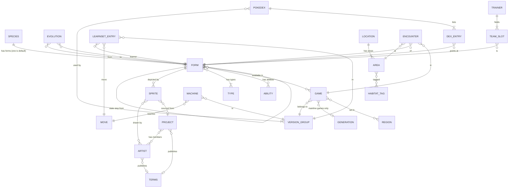

# Pokémon data model (ontology) spec

Status: approved direction. Michael reviewed version 1 on 2026-11-02 and asked for the changes in version 2. Phase 1 and phase 1b (core facts and the source audit, see the delivery plan) are built and on production. Phase 0 (sprite alignment) is in review on the work branch. Michael answered phase 1b's open questions on 2026-11-02. Each answer and what it changed is in `data/ontology/reports/classification-audit.json`.
Date: 2026-11-01, revised 2026-11-02.

## Summary

The app knows about Pokémon in three separate catalogs, with six ID schemes and more than 50 hard-coded exception lists. This spec proposes one connected data model: species, forms, sprites, artists, projects, games, moves, evolutions, and encounters, each an object with a stable ID and typed links. Every tool reads it through generated projections.

The first visible change it enables is sprite alignment. Today every sprite is roughly centered in its 96×96 canvas. A small grounded sprite such as Bulbasaur has 33 empty rows under its feet. With a `pose` and measured `bounds` on each sprite, grounded sprites stand 4 pixels above the floor of their box, and floating sprites move down half as far.

The work splits into seven phases. Phase 0 (sprite pose and bounds) stands alone and ships first. Phases 1 and 2 replace the three catalogs with one, and remove the cause of most current data bugs. Moves and encounters come after that.

## Why now

- **The same ID means two Pokémon.** ID `10179` is Galarian Stunfisk in the Dex and League, and Galarian Yamask in the Favorite Picker.
- **Facts disagree between copies.** Stereo Rotom is a spin-off form in one file and a temporary battle form in another. `formBst.json[10179]` is 303, and `pokemon.json[10179].bst` is 471.
- **Nothing can rebuild the catalog.** No script reproduces `src/data/pokemon.json`. Two of the old generators erase every form if someone runs them.
- **A new form is expensive.** One form needs hand entries in several files: the Picker form list, power-up forms, League forms, name catalogs, and sprite tables. The Mega form of a regional or cosmetic form is written in four places today.
- **Sprite pose needs a home.** A pose belongs to a drawing, not a species. The current data has no place for a per-drawing fact.

## Current state

This section records what the code does on 2026-11-01. Each claim cites the file that shows it.

### Three catalogs for one set of Pokémon

| Catalog | Rows | Key | Built from |
| --- | ---: | --- | --- |
| Dex catalog, `src/data/pokemon.json` | 1,089: 1,025 species and 64 forms | Dex app ID | Hand-typed Python tuples, then several partial refresh scripts and hand edits |
| Favorite Picker catalog, `src/favorites/model/catalog.ts` | 1,427: 1,296 Dex-derived and 131 power-up forms | Picker ID | The Dex catalog, about 200 hand-written forms in `alternateForms.ts`, and `powerupForms.json` |
| League catalog, `src/league/data/catalog.ts` | 1,210: the Dex rows plus 121 forms | Dex app ID | The Dex catalog plus `src/data/generated/league.json`, which `npm run ontology:build` writes. Until phase 2 it read `src/league/data/alternateForms.json`, generated from the Picker forms. |

The Dex catalog has no Mega, Gigantamax, or battle forms. Those exist only in the Picker and League form lists. The Dex catalog also has no species ID field. The form-to-species link lives in `src/i18n/alt-form-species.json` and `scripts/i18n/pokemon-id-map.json`.

### Six ID schemes, and one ID that means two Pokémon

The app uses Dex app IDs, Picker IDs, PokeAPI `pokemon` IDs, PokeAPI `pokemon_forms` IDs, name keys such as `picker:10227`, and sprite file names such as `alcremie-star`.

The schemes collide. ID `10179` is Galarian Stunfisk in the Dex and League, and Galarian Yamask in the Picker. `src/favorites/model/catalog.ts:80` translates between them by hand. `formBst.json[10179]` is 303, while `pokemon.json[10179].bst` is 471. Dex IDs `10254` to `10259` are app-minted Alcremie IDs, and PokeAPI uses the same numbers for six other Pokémon.

Saved data and the API store these IDs. `/api/submit` accepts exactly the IDs in `api/_chains.ts`. Any change of identity needs a saved-data migration.

### No reproducible build

No catalog script runs in `npm run build`, and none can rebuild the Dex catalog today.

- `scripts/combine_data.py` and `pokemon_gen1.py` to `pokemon_gen9.py` made the first file. They now differ from it in 12 stat sets, 23 capture rates, 68 growth rates, and 35 chain IDs. Running them erases every form and correction.
- `scripts/build-pokemon-data.ts` and `scripts/generate-data.cjs` read PokeAPI `master`, write default forms only, and drop shape, color, and egg groups. Running either one is destructive.
- `scripts/add-color-egg.mjs`, `add-shapes.mjs`, `sync-baby.mjs`, and `build-favorite-form-metadata.py --write` each patch some fields in place.
- No script writes the Alcremie or Urshifu rows.

### The same fact in several files

| Fact | Copies |
| --- | --- |
| Base stats and BST | `pokemon.json`, `formBst.json` (two scripts write it), `formMetadata.json`, League `alternateForms.json`, the audit `inventory.json` |
| Shape | `pokemon.json`, `src/data/form-shapes.json` applied at runtime, the shape `review.json` |
| Form to species | `alt-form-species.json`, `pokemon-id-map.json`, `api/_favoriteSpecies.json`, `favoriteBrowserIds.json`, League `powerupSpecies` |
| Spin-off status | `FORM_SOURCES` in `sourceGame.ts`, `LATER_DEBUTS` in `debut.ts`, `PICKER_ONLY_FORM_IDS` in League `formPolicy.ts`. They disagree: Stereo Rotom is a spin-off in one and temporary in another. |
| Game lists | `GAMES` in `sourceGame.ts` (16 codes) and `DEBUT_GAMES` in `debut.ts` (25 codes) |

### Sprites and credits

Every Pokémon sprite is a 96×96 PNG at `public/sprites/pokemon/<stem>.png`: 1,428 normal files and 1,397 shiny files. Only `src/lib/spriteUrl.ts` builds sprite paths. A catalog row links to its sprite through a URL string, not an ID. Every sprite record is keyed by file stem.

Sprite facts live in six files with three key vocabularies:

| File | Rows | Holds |
| --- | ---: | --- |
| `src/data/spriteAttribution.json` | 795 fan-made files | Artists, project (`via`), evidence prose |
| `docs/credits/sprite-evidence.json` | 2,825 | File hash, sources, verdict, where each file is shown |
| `src/data/creditTerms.json` | Projects and artists | Profile links, captured terms text, link evidence |
| `src/data/bundleCredits.json` | Generated | Acknowledgements counts per project and artist |
| `src/data/spriteRevisions.json` | 31 | Cache-busting versions for replaced files |
| `src/favorites/model/spriteInk.json` | 1,428 | A size measurement for the Picker chart |

Projects have three ID vocabularies: `via` values such as `smogon-gen6` in attribution, source IDs such as `pokeapi-sprites` in terms, and entry IDs such as `artist:kiriaura` in bundles. `ENTRY_BY_VIA` in `scripts/credits/bundle-credits.ts` maps between two of them. An artist can inherit a project's terms through `termsSource`, but only the data records it. The code does not resolve inheritance. By current policy, the Acknowledgements page quotes project terms on project entries and artist terms only for direct uploads.

No file records a sprite's opaque bounds. `spriteInk.json` stores a distance from the canvas center, so it cannot give the bottom padding. Measured on 2026-11-01: the bottom padding is 0 to 39 rows, and in 932 of 1,428 files it is within one row of the top padding. Most files are vertically centered.

### Facts the app does not have yet

Height, weight, abilities, gender ratio, egg cycles, base friendship, genus, evolution method and items, regional Dex numbers, per-game availability, and learnsets. `src/data/moves.json` has 845 moves with type, category, power, accuracy, and PP, but no learnsets, TM numbers, or version groups. The League TM picker lists all 845 moves.

### Prior art

The form metadata contract prototype, a private handoff of 2026-10-16, compared complete resolved records with sparse overrides for 1,388 forms. Both designs caught the same four historical errors. Resolved values cost 30,283 gzip bytes. Sparse values cost 3,086. Its recommendation was to keep sparse runtime data and validate at the offline refresh boundary. This spec keeps that recommendation.

## Target model

### Design rules

1. **One object, one ID.** Every object has a stable string ID, such as `pikachu`, `stunfisk-galar`, or `scarlet-violet`. TypeScript brands each ID type, so a `FormId` never passes where a `SpeciesId` belongs. Each form also has one frozen number, its `AppId`, which is unique across the whole app. Saved data, the API, and analytics store that number. See "IDs and saved data" below.
2. **A fact lives in one place.** Each fact has one owner object. Every other object reaches it through a link. A build check fails when two files state the same fact.
3. **Store sparse, read resolved.** A form states only the fields that differ from its species' default form. One shared resolver returns the complete record, so app code never walks an inheritance chain. The build checks every resolved value. Sparse storage keeps the bundle small: the earlier prototype measured 3,086 gzip bytes sparse against 30,283 resolved.
4. **A special case is a field.** A hard-coded list of IDs in app code is a defect. The behavior moves to a typed field or a link, with a source and a reason.
5. **A fact carries its provenance.** Each authored fact names its source: PokeAPI, a game data dump, Bulbapedia, Serebii, or a manual decision with a reason. Measured facts name the script that measured them.
6. **The ontology lives at build time. The browser gets projections.** The full graph never ships to a browser. Each tool imports a generated slice that holds only the fields it reads. The bundle budget gate stays in force.
7. **A link with properties is an object.** An evolution, a learnset entry, and an encounter each carry conditions. Each one is its own object type with its own fields, not a field on one end.

### IDs and saved data

- **One ledger.** `data/ontology/ids/app-ids.json` maps each `AppId` to its `FormId`. It is append-only, and `npm run ontology:mint` is its only writer. The checker compares it with production, so a number never changes meaning and never returns after retirement.
- **Numbering.** A default form's number is its National Dex number. Every other new form takes the next number from 20001, so nobody can read an `AppId` as a PokeAPI ID again. PokeAPI IDs are separate properties with their own brands.
- **Collisions.** Where a Dex number and a Picker number disagree today, the Dex number wins. The Dex, the League, and `/api/submit` change nothing.
- **Migrations.** The Picker's four colliding numbers (`10179`, `10180`, `10191`, `10227`) move in one saved-data migration. The League's saved power-up array position becomes a form ID in another.
- **Analytics.** Each Picker snapshot carries its own version. A version 1 snapshot holds the old Picker numbers, and the server translates them through `src/data/generated/picker-v1-numbers.json` when it reads the snapshot. Write time cannot decide this: a tab opened before a deploy keeps its old code for up to 7 days and keeps sending old numbers. A stored record is rewritten in the new numbers only when its client sends again.

App code crosses between numbers and IDs only at two functions, `fromAppId` and `appId`, at the storage, URL, and API boundaries.

### Object types and links



The diagram omits the reference vocabularies (color, shape, egg group, growth rate, tags, variety axes) and localized names. Each of those is a small object type that other objects link to by ID.

### Species and form

A **species** holds the facts that every form shares. A **form** is one distinct Pokémon a person can pick: a default form, a regional form, a pattern, a Mega, a female with a different look. Every species names exactly one default form, and a form does not repeat that fact. The app picks, filters, and shows forms, never bare species.

```ts
type SpeciesId = Brand<string, 'SpeciesId'>   // 'raichu'
type FormId = Brand<string, 'FormId'>         // 'raichu', 'raichu-alola', 'raichu-mega-x'
type AppId = Brand<number, 'AppId'>           // the frozen number saved data and the API store

interface Species {
  id: SpeciesId
  nationalDex: number                // 26
  defaultForm: FormId
  genderRatio: GenderRatio           // { kind: 'genderless' } | { kind: 'ratio'; femaleEighths: 0..8 }
  hatchCycles: number
  captureRate: number
  baseFriendship: number
  growthRate: GrowthRateId
  legendaryClass: 'none' | 'sub-legendary' | 'restricted' | 'mythical' | 'ultra-beast'
  paradox?: { era: 'ancient' | 'future'; mirrors: SpeciesId }
  convergentOf?: SpeciesId
  tags: SpeciesTagId[]               // flags with no payload: baby, fossil, pseudo-legendary
  varietyAxes?: { axis: VarietyAxisId; values: VarietyValueId[] }[]  // the axes its forms vary on
  standIn?: { [tool in ToolId]?: FormId }  // a tool shows another form's art, such as Wishiwashi School in the Dex
  names: LocalizedText
  genus: LocalizedText               // "Mouse Pokémon"
  externalIds: ExternalIds
}
```

Generation, evolution family, and debut game are derived. Generation comes from the default form's debut game. The family is the connected set of evolutions.

#### How forms are classified

A single `kind` per form breaks on forms that are two things at once. Mega Magearna Original Color is a Mega and a color variant. Galarian Darmanitan Zen Mode is regional and a battle state. Independent yes/no flags (`isMega`, `isRegional`) fix that, but they create five other problems:

1. Impossible states compile, such as `isMega` and `isPrimal` both true.
2. A flag has no payload. It cannot say which region, which Mega Stone, or which letter.
3. `false` cannot tell "no" from "nobody recorded it".
4. A new category adds a column to every row.
5. A fact that follows from structure must be copied by hand. A Mega of a Galarian form is Galarian, and a copied flag drifts.

The data-model practice for this is **faceted classification**. Each independent dimension (facet) has a small closed set of values with an explicit "none", and each form takes one value per facet. Product catalogs use it for size, color, and material. It keeps the independence of Michael's proposed flags and adds payloads, exclusivity within a facet, and an explicit "none".

Pokémon need one refinement. A Mega or a battle state is not a point in the same space as a regional form. It is a transformation of another form. So a form's classification has two parts:

- **Coordinates**, for permanent forms: `region`, `variety` (axes the species declares, such as letter, pattern, cream and sweet, appliance, breed, mask, or outfit), `sex`, and `fusion`. A permanent form states all four, absent meaning none. No two permanent forms of a species can share coordinates. That check alone would have caught the old duplicate Rapid Strike Urshifu (Picker `10191`, Dex `10227`).
- **A state step**, for temporary forms: exactly one step (`mega`, `primal`, `gigantamax`, `eternamax`, `ultra-burst`, `terastal`, `battle-mode`, `move-look`, or `ride`) and the forms that enter it. A state form takes its coordinates from the forms it is entered from, and its chain is their chain plus its own step.

```ts
interface Coordinates {
  region: RegionId | null            // Galarian, Hisuian, Paldean
  variety: { [axis: string]: VarietyValueId }  // { letter: 'a' }, { cream: 'vanilla', sweet: 'star' }
  sex: 'male' | 'female' | null      // set only when the sexes look or play differently; then both sexes are forms
  fusion: SpeciesId | null           // Kyurem White has 'reshiram'
}

type FormState =
  | { kind: 'mega'; stone: ItemId; letter?: 'x' | 'y' }
  | { kind: 'primal'; orb: ItemId }
  | { kind: 'gigantamax'; move: MoveId }
  | { kind: 'eternamax' }
  | { kind: 'ultra-burst'; item: ItemId }
  | { kind: 'terastal'; teraType: TeraType }
  | { kind: 'battle-mode'; trigger?: StateTrigger } // Zen Mode, Blade Forme, School, Complete, Ash, Hero
  | { kind: 'move-look'; move: MoveId }             // Overdrive, Radiant Sun
  | { kind: 'ride' }                                // Koraidon Limited Build

// The ability that starts the step: Schooling for Wishiwashi School, Zero to Hero for Palafin Hero,
// Shields Down for each Minior Core. The checker proves every form the step enters from has it.
// A battle-mode step without a trigger has none recorded yet.
type StateTrigger = { ability: AbilityId }

// What a person writes. The types forbid mixing the two shapes.
type PermanentFormEntry = { id: FormId } & Partial<Coordinates> & Partial<FormFacts> & { state?: never; tools: ToolInclusion }
type StateFormEntry = { id: FormId } & { [K in keyof Coordinates]?: never } & Partial<FormFacts> & {
  state: FormState & { from: [FormId, ...FormId[]] | 'any' }
  tools: ToolInclusion
}
```

The yes/no flags still exist. The build derives them, and the resolved form exposes them as `form.is.mega`, `form.is.regional`, `form.is.battleOnly`, and so on. Nobody authors them, so they cannot disagree with the structure.

| Form | How it is written | Derived flags |
| --- | --- | --- |
| Alolan Raichu | `region: 'alola'` | regional |
| Mega Magearna Original Color | `state: { kind: 'mega', from: ['magearna-original'] }` | mega, variety, battle-only |
| Galarian Darmanitan Zen Mode | `state: { kind: 'battle-mode', from: ['darmanitan-galar'] }` | regional, battle-only |
| Mega Floette | `state: { kind: 'mega', from: ['floette-eternal'] }` | mega, battle-only |
| Paldean Tauros Aqua Breed | `region: 'paldea', variety: { breed: 'aqua' }` | regional, variety |
| Gigantamax Alcremie | `state: { kind: 'gigantamax', from: 'any' }` | gigantamax, battle-only |
| Meowstic female | `sex: 'female'` with its own abilities | sex |
| Pikachu female | `sex: 'female'` with no other field | sex, look only |
| Cap Pikachu | `variety: { outfit: 'cap-original' }`, `shiny: { locked: … }`, `obtain: 'event-only'` | variety, event |
| Shadow Lugia | `variety: { look: 'shadow' }`, `debut: 'pokemon-xd'` | variety, spin-off |
| Terapagos Stellar | a `terastal` step from Terapagos Terastal, itself a `battle-mode` step | two-step chain |
| Minior Red Core | `state: { kind: 'battle-mode', trigger: { ability: 'shields-down' }, from: ['minior'] }` | battle-only |
| Mega Meowstic female | `state: { kind: 'mega', from: ['meowstic-female'] }`, Picker and League verdicts `{ mergedInto: 'meowstic-mega' }` | mega, battle-only |

A future regional Mega is a `mega` step from the regional form. It needs no schema change.

#### What a form owns, and what it inherits

```ts
interface FormFacts {
  types: [TypeId] | [TypeId, TypeId]
  abilities: { first: AbilityId; second?: AbilityId; hidden?: AbilityId }
  baseStats: { hp: number; atk: number; def: number; spa: number; spd: number; spe: number }
  heightDm: number                   // decimeters, as the games store it
  weightHg: number                   // hectograms, as the games store it
  color: ColorId
  shape: ShapeId
  eggGroups: EggGroupId[]            // on the form: Eternal Floette and Cap Pikachu differ from their species
  debut: GameId
  obtain: 'standard' | 'event-only' | 'story-only' | 'spinoff-only' | 'unobtainable'
  shiny: 'available' | { locked: string }   // the reason, quoted on hover
}
```

There is one inheritance rule. A permanent form inherits every fact it does not state from its species' default form. A state form inherits from the first form it is entered from. The default form states every core fact. The build derives `bst`, persistence (`permanent`, `battle`, or `field`), the flags, the generation, and whether the form differs only in looks.

Two checks catch the drift that inheritance leaves open. `state-twin-differs` fails when two copies of the same state disagree, and `state-stats-missing` fails when a state form changes types but not stats.

#### Tool inclusion

Every resolved form has a `tools` field: `{ picker, dex, league }`. Each value is `'in'` or the reason it is out.

```ts
type ToolVerdict = 'in' | { out: OutReason }
type OutReason =
  | 'battle-state'                   // the checker proves the form has a state step
  | 'spinoff-only'                   // the checker proves the debut game is not mainline
  | 'look-only'                      // the checker proves no fact differs from the default form
  | { decision: string }             // a product call, citing where Michael made it
  | { mergedInto: FormId }           // one of two records with one look; the tool shows the target
type ToolInclusion = { picker: ToolVerdict; dex: ToolVerdict; league: ToolVerdict }
```

Some forms are two records with one look. Male and female Meowstic Mega Evolve into one design, and so do male and female Pyroar, and Amped and Low Key Toxtricity when they Gigantamax. Each entry form gets its own state form with its own facts: the Low Key Gigantamax keeps Low Key's abilities. The twin that was added second states `{ out: { mergedInto: <first twin> } }` in each tool that lists the first one, so no tool draws the same Pokémon twice. The checker proves the claim: both forms belong to one species, use one sprite, and have the same state steps, and the target is `in` for that tool. It also fails when a tool shows two forms of one species with one sprite and one state chain, so a new twin cannot ship without the verdict. Both records stay complete in the ontology. A tool that needs the facts of each, such as the abilities in a team builder, reads both records through `canBecome` and draws the target's look. A tool that reaches a merged form, such as the Mega of a female Meowstic, shows the target.

A default form is in every tool unless it states otherwise. Every other form must state all three verdicts, so a new form cannot ship without a decision for each tool. A structural reason is a claim the checker proves, so a wrong reason fails the build. The build also writes a report of every form's verdicts, so a policy change shows as a reviewable diff. This replaces `TEMPORARY_FORM_IDS`, `PICKER_ONLY_FORM_IDS`, `FUSION_FORM_IDS`, `EXCLUSIVE_FORM_GROUPS`, the Unown exclusion, and the League and Picker eligibility lists.

#### Shiny

Shiny is a coloration, not a form. Every form has a normal and a shiny look, unless `shiny` says it is locked. No appearance record exists.

### Sprite, artist, project, and terms

A **sprite** is one image file, keyed by its file stem. It depicts one form, normal or shiny.

```ts
type SpriteId = Brand<string, 'SpriteId'>    // the file stem: '25', '10100', 'alcremie-star'

interface NormalSprite {
  id: SpriteId
  depicts: FormId
  style: SpriteStyleId               // 'gen5-dot' today
  file: string                       // path under public/sprites
  channel: ProjectId | 'own-upload' | 'game-rip'   // how the file reached the app
  credits: { artist: ArtistId; role: 'drew' | 'edited' | 'cleaned-up' | 'shiny' }[]
  basedOn?: SpriteId                 // an edit of another sprite
  evidence: EvidenceRef
  pose: 'grounded' | 'floating'      // a person's judgment of this drawing
}

interface ShinySprite {
  id: SpriteId                       // 'shiny/25'
  shinyOf: SpriteId                  // shares pose and bounds; check-shiny-masks proves the outline matches
  credits: { artist: ArtistId; role: 'shiny' }[]   // only its own work; the normal sprite's credits are added
  evidence: EvidenceRef
}

interface Artist {
  id: ArtistId
  displayName: string
  creditedAs?: string[]
  links: { label: string; url: string; proof: EvidenceRef }[]
  terms?: TermsId                    // the artist's own published terms
}

interface Project {
  id: ProjectId                      // 'smogon-sprite-project', 'pokeapi-sprites'
  name: string
  links: { label: string; url: string; proof: EvidenceRef }[]
  terms?: TermsId
}

interface Terms {
  id: TermsId
  text: string                       // the plaintext, as captured
  url: string
  capturedAt: string
  sha256: string                     // proves the text did not change since capture
  reading: {                         // a person's dated reading of the text
    use: Grant; commercial: Grant; modify: Grant; credit: 'not-required' | 'requested' | 'required'
    readBy: string; readAt: string
  }
}
type Grant = 'yes' | 'unclear' | 'no'
```

Measured values live in a generated file beside the authored rows: opaque bounds and ink per sprite, with the MD5 of the measured file. A check fails when a file changes after its measurement. The build bakes the alignment offset into each catalog row, so a renderer reads one integer.

#### Effective terms

Michael's rule: for a sprite that came through a project, the more permissive of the project's terms and the artist's own terms applies. Project terms normally apply to sprites sourced through that project.

1. **Per artist.** For each credited artist, compare the project's terms with that artist's own terms. "More permissive" is a product order on four readings: use, commercial use, modification (`yes` beats `unclear` beats `no`), and credit (`not-required` beats `requested` beats `required`). One set wins only if it is at least as permissive on all four.
2. **Tie or no ranking.** When the two are equal, or neither is at least as permissive on all four, the project's terms apply. The build lists each unranked pair in a review report.
3. **Per sprite.** A sprite with several artists is bound by every artist's result at once. Its effective terms are the least permissive result on each reading. One artist's generous terms never waive another artist's terms.
4. **Other channels.** An own upload uses the artist's terms. A game rip has no artist terms.

The Acknowledgements page always credits every artist, whatever the terms say about credit. A reading is a person's judgment of legal text, so each reading names its reader and date.

#### Pose and alignment

Michael approved these rules on 2026-11-02. Let `pad` be the number of empty rows under the lowest opaque row.

- **Grounded:** the sprite moves down `max(0, pad - 4)` native pixels, so its feet sit 4 native pixels above the floor of the sprite box.
- **Floating:** the sprite moves down half that distance, rounded to a whole native pixel.
- **No sprite moves up.** A grounded sprite with fewer than 4 empty rows stays where it is. Of the 66 sprites this affects, 47 already touch the top edge, so lifting them would clip their art.

`pose` describes the drawing, not the species. Two artists can draw Mega Eelektross differently, so each sprite carries its own value. The PNG files stay unchanged.

### Games, generations, regions, and Pokédexes

A **game** is one release, such as Scarlet or Pokémon XD. A **version group** joins paired releases that share data, such as Scarlet and Violet. Learnsets and machines belong to version groups, because paired games share them. Encounters belong to single games, because version exclusives differ.

```ts
interface Game {
  id: GameId                         // 'scarlet', 'pokemon-xd', 'pokopia', 'legends-za'
  versionGroup: VersionGroupId       // 'scarlet-violet'
  series: 'mainline' | 'spinoff' | 'mobile'
  generation?: GenerationId          // mainline games only
  regions: RegionId[]
  platform: string
  releaseDate: string
  names: LocalizedText
}

interface Pokedex {
  id: PokedexId                      // 'paldea', 'kitakami', 'national'
  region?: RegionId
  versionGroups: VersionGroupId[]
  entries: { number: number; form: FormId }[]
}
```

A spin-off game is a game like any other. Pokémon Ranger, Mystery Dungeon, XD, Pokkén, Pokopia, and GO each get a `Game` record. A spin-off form names its game in `debut`. A filter such as "forms from spin-off games" becomes `form.is.spinoff`, derived from the debut game's series, and "forms from Pokkén" becomes `form.debut === 'pokken'`.

Starter Pokémon also become a link. Pikachu is the starter of Yellow, and Eevee is a starter of Let's Go, Eevee! A starter is a relation between a game and a form (`Game.starters: FormId[]`), not a tag on a species.

### Evolution

An **evolution** is an object with conditions, from one form to another. Conditions can differ by game, so an evolution can carry several condition sets.

```ts
interface Evolution {
  id: EvolutionId
  from: FormId
  to: FormId
  methods: {
    games: VersionGroupId[] | 'all'
    trigger: 'level-up' | 'use-item' | 'trade' | 'other'
    conditions: EvolutionCondition[] // level, item, held item, friendship, time, location, move known, gender, stats, party, weather ...
  }[]
}
```

The Evolution Levels page, family grouping, and evolution-stage filters all read this one object type.

### Moves, machines, and learnsets

```ts
interface Move {
  id: MoveId
  type: TypeId
  category: 'physical' | 'special' | 'status'
  power?: number
  accuracy?: number
  pp: number
  priority: number
  generation: GenerationId
  names: LocalizedText
}

interface Machine {                   // TM, TR, HM, or technical record
  id: MachineId                       // 'scarlet-violet/tm-001'
  versionGroup: VersionGroupId
  label: string                       // 'TM001'
  move: MoveId
}

interface LearnsetEntry {
  form: FormId
  move: MoveId
  versionGroup: VersionGroupId
  method:
    | { kind: 'level-up'; level: number }
    | { kind: 'evolution' }
    | { kind: 'machine'; machine: MachineId }
    | { kind: 'tutor' }
    | { kind: 'egg' }
    | { kind: 'reminder' }
    | { kind: 'event'; distribution: DistributionId }
}
```

A learnset is the set of `LearnsetEntry` rows for one form in one version group. The League builder's request, "show the TMs most of my team can learn", becomes a count over `method.kind === 'machine'` rows for the chosen forms and version group.

Learnsets are the largest table in the model. They never ship whole. The build writes one file per version group, and the League builder loads only the version group it shows.

### Locations, areas, habitats, and encounters

A **location** is a named place, such as Route 1 or Mt. Moon. An **area** is a part of a location with its own encounter table, such as Route 12's tall grass, its water surface, or Mt. Moon B1F. A **habitat tag** describes an area, and an area can have several tags, such as `grassland`, `water-surface`, and `night-only`.

```ts
interface Location {
  id: LocationId                     // 'kanto/route-12'
  region: RegionId
  names: LocalizedText
  areas: AreaId[]
}

interface Area {
  id: AreaId                         // 'kanto/route-12/water-surface'
  location: LocationId
  habitats: HabitatTagId[]
}

interface Encounter {
  game: GameId
  area: AreaId
  form: FormId
  method: EncounterMethodId          // walk, surf, old-rod, headbutt, static, gift, trade, raid, outbreak ...
  levels: [number, number]
  rate?: number                      // percent, when the table has one
  conditions?: EncounterCondition[]  // time, season, weather, story flag
  shiny: 'random' | 'locked' | 'guaranteed'
}
```

A list such as "Pokémon that appear shiny in static encounters" becomes a query: `Encounter.shiny === 'guaranteed'`. The red Gyarados at the Lake of Rage is one encounter row, not an exception in app code. Today the same five IDs live in two places: the `shinyIds` of the static and reward archetypes in `src/data/archetypes.ts`, and `PROTECTED` in `scripts/fetch-shiny-sprites.ts`.

Most of the raw material exists already. A PokeAPI encounter extract in the private biome research holds 83,092 encounter rows across 41 versions, with location areas and methods. `scripts/biome/` scores habitats from them. No code in `src/` reads any of it yet. The live habitat model is the 16 place archetypes in `archetypes.ts`. Scarlet and Violet, Legends: Arceus, and Legends: Z-A have no encounter data.

A **distribution** is an event or mystery gift. It links a form, a game, a date range, a shiny status, and a special moveset. Event-only moves are learnset entries whose method names the distribution.

### Other object types

These object types follow from the ones above. Each earns its place through a current or listed feature.

| Object type | What it holds | Why the app needs it |
| --- | --- | --- |
| Type and type matchup | 18 types plus Stellar, and the multiplier for each attacker and defender pair, by generation | Type filters, type badges, and coverage charts already use it. Fairy and Steel changed the chart over time. |
| Ability | Name, description, generation | Form abilities, and a future team builder. |
| Item | Evolution items, Mega Stones, held items | Evolution conditions and state steps link to it. |
| Trainer and team | A gym leader, Elite Four member, or rival, with team slots: form, level, moves, item, ability | The League builder models gym leaders today. Real rosters become references. |
| Reference vocabularies | Color, shape, egg group, growth rate, species tag, habitat tag, encounter method | Each has an ID, localized names, and an icon where one exists, such as the shape icons in `public/shapes`. |
| Localized text | Names and terms per locale, keyed by object ID | The i18n catalogs become properties of objects instead of a parallel ID scheme. |
| Data source | PokeAPI release, game dump, Bulbapedia page, Serebii page, or a manual decision | Provenance for every authored fact, and the data credit on the Acknowledgements page. |

App concepts stay outside the ontology. Dex Builder sections, League rules, Favorite Picker eligibility, and fan-made archetypes are app features. They reference ontology IDs. They do not add fields to `Species` or `Form`.

## Storage, build, and runtime

### Where authored data lives

Two rules decide where a fact lives. A fact about a Pokémon lives in its species file. A fact about a game, such as a learnset, an encounter, or a Pokédex number, lives in that version group's folder.

```text
data/ontology/
  species/0026-raichu.json          species fields, then its forms in display order, then evolutions into it
  ids/app-ids.json                  the AppId ledger; only ontology:mint writes it
  sprites/gen5-dot.json             one row per sprite: file, depicts, artists, project, pose
  credits/artists.json              artists, links, terms references
  credits/projects.json             projects, terms references
  credits/terms/<id>.txt            captured plaintext terms
  games/scarlet-violet/game.json    games, version group, starters, regions
  games/scarlet-violet/pokedexes.json
  games/scarlet-violet/learnsets.json
  games/scarlet-violet/machines.json
  games/scarlet-violet/encounters.json
  vocab/*.json                      types, colors, shapes, egg groups, tags, habitats
  moves.json, abilities.json, items.json, evolutions.json
```

A new species touches one species file and one sprite row. A new game adds one folder. Measured values, such as sprite bounds and ink, stay in generated files beside the authored rows, so a person never edits a measured number by hand.

### What the build produces

`npm run ontology:build` reads `data/ontology/`, checks it, resolves form inheritance, and writes typed projections into `src/data/generated/`.

| Projection | Reader | Content |
| --- | --- | --- |
| `catalog.ts` | Shared browser, Dex Builder, League, Picker | One sparse row per form, plus the shared resolver that returns complete records |
| `sprites.ts` | Every sprite renderer | Sprite key to file, revision, pose, and bounds |
| `favorites.ts` | Favorite Picker | The fields its eligibility and sort read |
| `learnsets/<versionGroup>.json` | League builder, loaded on demand | Machine compatibility per form |
| `credits.ts` | Acknowledgements | Artists, projects, and effective terms |

Each projection is a pure function of the ontology. The bundle budget gate measures the projections the same way it measures `pokemon.json` today.

### Checks

`npm run ontology:check` runs in every code CI mode. It fails when:

1. A link points at an ID that does not exist.
2. A form has no sprite for a style that a tool uses.
3. A sprite has no `pose`, no credit evidence, or bounds that are out of date with its file.
4. Two permanent forms of one species share coordinates, a form has no verdict for a tool, or a structural verdict is false.
5. A ledger number changed meaning or disappeared, two files state the same fact, or app code adds a list of Pokémon IDs. A lint rule rejects a numeric array or set of Pokémon IDs in `src/`.

Each error names the file and the field to fix, like the sprite credit check does today.

## Adding a new generation

1. Add the new games, version group, regions, and Pokédexes under `data/ontology/games/`.
2. Run the PokeAPI importer for the new species and forms. It writes species files with `source: pokeapi@<release>` on each fact.
3. Add each sprite row, then run the measurement script for bounds and ink.
4. Set each new sprite's pose.
5. Run `npm run ontology:check`, then fix each error it names.

Each step ends in a check that fails until the step is complete, so a partial generation cannot ship.

## Delivery plan

Each phase is one pull request that ends in a check. A phase starts only when the one before it is merged. Phases 1 to 3 change no screen, so each one proves itself with a generated-output comparison, not with screenshots.

| Phase | Delivers | Proof |
| --- | --- | --- |
| 0. Sprite pose and bounds | `pose` and measured `bounds` for every sprite file. One shared alignment helper used by every sprite renderer. Grounded sprites stand 4 pixels above the floor, and floating sprites move down half as far. | A check fails when a sprite has no pose or stale bounds. `/verify-my151` before-and-after shots on every surface that draws a sprite. |
| 1. Ontology scaffold | `data/ontology/` with every species and form the three catalogs know (1,427 identities), plus the `AppId` ledger. A generator writes today's catalog files from it. | The generated `pokemon.json` is byte-identical to today's. The Picker and League catalogs return the same records at runtime. |
| 1b. Core facts and source audit | Abilities, height, weight, shiny locks, gender ratio, hatch cycles, base friendship, and genus, each with provenance, from PokeAPI at one pinned commit. Every classification and every fact already in the ontology compared with that snapshot; each disagreement reviewed in `data/ontology/reports/`. | `pokemon.json` stays byte-identical and parity holds. The check fails on a missing core fact, an unknown ability, or an unreviewed disagreement, with the file and field named. |
| 2. One catalog | The Dex, League, and Picker read the generated projections. Duplicate tables are deleted: `formBst.json`, `alt-form-species.json`, `favoriteBrowserIds.json`, and the hand-written ID translations. The Picker's four colliding IDs migrate in saved data. | Saved-data migration tests. Every catalog consumer's existing tests pass. Bundle budget holds. |
| 3. Exceptions become fields | Each hard-coded list in the census below becomes a typed field or link. A lint rule rejects a new list of Pokémon IDs in `src/`. | For each list: the field-driven result equals the list. The lint fails on a planted list. |
| 4. Sprites and credits | `spriteAttribution.json`, `sprite-evidence.json`, and `creditTerms.json` merge into sprite, artist, project, and terms objects. Effective terms are derived by the rule in "Effective terms". | `credits:check-sprites` passes against the new source. The Acknowledgements page is unchanged in screenshots. |
| 5. Games and learnsets | Game and version group objects. Machines and learnsets from PokeAPI, pinned to one revision. The League TM picker can sort by "learnable by most of my team". | Learnset row counts match the pinned PokeAPI CSV. The new filter ships only after Michael approves it from pictures. |
| 6. Locations and encounters | Location, area, habitat tag, and encounter objects. The biome pipeline in `scripts/biome/` reads them. Shiny-guaranteed encounters become encounter rows. | Encounter counts match the pinned source for each game. |

Phase 0 needs no other phase. It writes `pose` and `bounds` in a file that phase 4 later folds into the sprite object.

Phases 1 and 2 are the expensive ones. They also remove the cause of most current data bugs: three catalogs and six ID schemes. Phases 5 and 6 are optional. They are cheap after phase 2, and very expensive before it.

## Exception census

Each row is a hard-coded list in app code or scripts today, and the field or link that replaces it. Phase 3 converts them. For each list, a check proves that the field-driven result equals the old list before the list is deleted.

### Classification

| Today | Entries | Replaced by |
| --- | ---: | --- |
| `ULTRA_BEAST_IDS`, `src/data/categories.ts:15` | 11 | `species.legendaryClass = 'ultra-beast'` |
| `PARADOX_IDS` and its subgroups, `categories.ts:17,134-143` | 20 | `species.paradox { era, mirrors }` |
| `LEGENDARY_PARADOX_IDS`, `categories.ts:19` | 6 | Delete. `isLegendary` already flags all six. |
| `CONVERGENT_IDS`, in `categories.ts:21` and again in `src/favorites/model/catalog.ts:17` | 4 | `species.convergentOf` |
| Sub-legendary and Restricted columns, `categories.ts:60-61,176-177` | 44 and 27 | `species.legendaryClass` |
| `FOSSIL_IDS` and `PSEUDO_LEGENDARY_IDS`, `categories.ts:147,156` | 26 and 35 | `species.tags` |
| `STARTER_IDS`, `categories.ts:162`, plus Pikachu and Eevee inline at `favorites/model/catalog.ts:184` | 86 | `Game.starters` links |
| Regional form found by matching `-alola` and similar in the slug, in at least four regex copies | n/a | The `region` coordinate |

### Form behavior

| Today | Entries | Replaced by |
| --- | ---: | --- |
| `TEMPORARY_FORM_IDS`, `src/league/data/formPolicy.ts:3` | 40 | A state step, and the derived `is.battleOnly`. Deleted in phase 2: the League reads its forms from the ontology's `tools.league` verdict. |
| `FUSION_FORM_IDS`, `formPolicy.ts:11` | 6 | The `fusion` coordinate. Deleted in phase 2, as above. |
| `PICKER_ONLY_FORM_IDS`, `formPolicy.ts:17` | 13 | `tools.league` verdict `spinoff-only`, proved from `debut`. Deleted in phase 2, as above. |
| `STANDALONE_FORM_IDS`, `src/league/data/formPolicy.ts:1` | 17 | Derived: a form with no evolution links |
| `FORM_PARENT_IDS` and `ADDITIONAL_EVOLUTION_EDGES`, `formPolicy.ts:33,46` | 31 | `Evolution` objects, with `preserves` for edges that keep a facet such as sex or season. Deleted in phase 2: `src/data/generated/league.json` carries each League row's parent and the evolutions beyond its first. |
| `TERASTAL_FORM_IDS`, Ultra Necrozma, Eternamax, `favorites/model/catalog.ts:173,180`, `sortKeys.ts:28` | 8 | State steps: `terastal`, `ultra-burst`, `eternamax` |
| `EXCLUSIVE_FORM_GROUPS`, `src/hooks/usePokemonData.ts:36` | 9 | Derived: sibling evolutions that need different items |
| `ALTERNATE_PICKER_FORMS`, `favorites/model/alternateForms.ts:39-208` | 211 | Form records in the ontology |
| `ALTERNATE_FORMS` and `PRIMAL_ORBS` (matches English label text), `src/league/model/powerups.ts:15,50` | 14 | State steps `mega`, `primal`, and `gigantamax`, each with its `from` forms |

### Names, stats, color, and shape

| Today | Entries | Replaced by |
| --- | ---: | --- |
| `MALE_FORM_IDS`, `src/i18n/genderForms.ts:3` | 13 | The `sex` coordinate |
| `cosmeticGenderIds`, `scripts/build-favorite-bst.ts:16` | 4 | `sex: 'female'` with no other fact, derived as look-only |
| Urshifu name and the `picker:10227` key, in four files | 4 sites | `form.names` |
| `sharedRecords`, `build-favorite-bst.ts:18` | 23 | Sparse inheritance from the default form |
| `formMetadata.json`, `formBst.json`, `powerupTypes.json`, League `alternateForms.json` metadata | 213, 1,427, 128, 80 | Form fields, stored once |
| `form-color-overrides.json` (keyed by Dex ID) and `form-shapes.json` (keyed by Picker ID) | 48 and 30 | `form.color` and `form.shape` |
| Zacian and Zamazenta type repair, `favorites/model/catalog.ts:86` | 2 | Delete. `pokemon.json` already has the right types. |

### Shiny, sprites, and display

| Today | Entries | Replaced by |
| --- | ---: | --- |
| Static and reward `shinyIds`, `src/data/archetypes.ts:518,632`, and the same IDs in `PROTECTED`, `scripts/fetch-shiny-sprites.ts:78` | 5 | `Encounter.shiny = 'guaranteed'` |
| `held` never-shiny forms with reasons, `scripts/data/shiny-sprite-sources.json` | 20 | `shiny: { locked: reason }` |
| `pokemon.json` `sprite` that points at another form (Wishiwashi School, Palafin Hero, Terapagos Terastal) | 13 | `species.standIn.dex` |
| Picker sprite reset for 746, 888, 889, 964, 1024, `favorites/model/catalog.ts:88` | 5 | The default form's sprite, with no override |
| Form order for Ogerpon, Kyurem, Necrozma, Terapagos, Cosplay Pikachu (two copies), Eternal Floette | 11 | Order of forms in the species file |

### Games and identity

| Today | Entries | Replaced by |
| --- | ---: | --- |
| `GAMES` in `sourceGame.ts`, `DEBUT_GAMES` and `GAME_REGION` in `debut.ts`, `REGIONAL_DEXES` | 16, 25, 9 | `Game`, `Region`, and `Pokedex` objects |
| `FORM_SOURCES`, `sourceGame.ts:120` | 39 | `debut` and `obtain` |
| `LATER_DEBUTS` by ID range, `debut.ts:19` | 24 ranges | `debut` |
| Picker-to-Dex ID remaps in `favorites/model/catalog.ts:80`, League `catalog.ts:108-111`, `favoriteBrowserIds.json` | 341 | One `appId` per form |

App concepts stay as app data. The 33 archetypes in `archetypes.ts`, Dex sections, and League rules are features. They reference ontology IDs, and their place lists can later derive from encounter habitats.

## Risks found during the audit

These are defects or risks in the current code. None of them is fixed by this spec. Each one names the phase that removes its cause.

1. **A saved power-up points at an array position.** League saves `Powerup.index`, a position in the forms list from `powerupForms.json` (`src/league/model/engine.ts:72`). That file is regenerated from PokeAPI `master`. A regeneration that inserts a form shifts every saved pick after it. Phase 2 saves a form ID instead.
2. **Two generators can erase the catalog.** `scripts/build-pokemon-data.ts` and `scripts/generate-data.cjs` overwrite `pokemon.json` with default forms only. `scripts/combine_data.py` erases every form and correction. Phase 1 deletes them.
3. **`scripts/sync-baby.mjs` maps colliding IDs to the wrong species.** It looks up form IDs in PokeAPI `pokemon.csv` and skips the identity guard in `scripts/pokemon-source-identity.mjs`. No baby flag is wrong today. Phase 1 removes the separate ID lookups.
4. **The biome builder reads TypeScript source with a regular expression.** `scripts/biome/build-assignments.mjs:207-230` parses `categories.ts` and `archetypes.ts`. If a set moves, it returns an empty set and does not fail. Phase 3 gives it data to read.
5. **Mega Floette is offered on plain Floette.** `src/league/data/powerupForms.json` lists Mega Floette under key `670`, plain Floette. In Legends: Z-A, only Eternal Floette Mega Evolves. The state step `from: ['floette-eternal']` removes the cause. Phase 2 fixes it.
6. **Unpinned upstream data.** `scripts/league/fetch-moves.ts` and `scripts/league/fetch-powerup-forms.ts` read PokeAPI `master`, so a rerun can change output with no code change. No CI step runs `npm run league:forms -- --check`. Phase 5 pins every source to one PokeAPI revision.

## Decisions

Michael decided these on 2026-11-02.

| Topic | Decision |
| --- | --- |
| Sprite alignment | Grounded sprites stand 4 native pixels above the floor. Floating sprites move down half as far. |
| IDs | Every Pokémon and form has one unique ID. One number never means two Pokémon again. |
| Facts | One source of truth per fact. No fact repeats in two files. |
| Tool inclusion | Each form records whether the Picker, the Dex Builder, and the Gym Builder include it. |
| Exception lists | Every hard-coded ID list becomes a field or link in the model. |
| Form classification | Michael proposed independent yes/no fields instead of one kind. Version 2 uses facets plus state steps, and derives the yes/no fields (see "How forms are classified"). |
| Credits | A sprite can credit several artists. Projects and artists both have links. |
| Effective terms | The more permissive of the project's and the artist's terms applies. Project terms normally apply to sprites sourced through a project. |
| Twin forms | Mega Meowstic, Mega Pyroar, and Gigantamax Toxtricity each have one look for both entry forms. The ontology keeps a record per entry form, and no tool shows both (see "Tool inclusion"). |
| Xerneas | Active Mode stays the default form and the sprite the Dex and Gym Builder show. |
| Minior | The Cores are battle-mode states triggered by Shields Down, modeled like Wishiwashi School and Palafin Hero. |

Three design candidates, each from a different model, informed version 2. All three rejected both one kind per form and authored yes/no flags, for the reasons in "How forms are classified".

## Open questions

1. **Pose review.** The appendix seed is a model's labeling. Michael has not confirmed it. Corrections come from his scan of the floating and unsure sheets, or from reports.
2. **Look-only forms in the Gym Builder.** Vivillon patterns and Furfrou trims change no stats. Version 2 keeps today's verdicts until Michael decides otherwise.
3. **Who reads terms.** A terms reading is a judgment of legal text. Version 2 records a reader and a date on each reading, and assumes Michael is the reader of record.
4. **Learnsets for the Gym Builder.** "Can learn" can use each form's latest game, or Scarlet and Violet only. This waits for phase 5.

## Appendix: sprite pose seed

Three reviewers labeled all 1,428 normal sprite files from contact sheets of 48 sprites each, by the drawing only. This is a seed for review, not a decision. Every stem not listed here is `grounded`.

Floating (326): 12, 15, 17, 22, 41, 42, 49, 70, 72, 73, 74, 81, 82, 92, 93, 109, 110, 116, 117, 118, 119, 129, 130, 142, 144, 145, 146, 151, 169, 170, 171, 176, 187, 189, 193, 200, 201, 207, 211, 223, 226, 230, 249, 250, 251, 267, 269, 278, 284, 291, 292, 311, 312, 318, 319, 329, 330, 333, 334, 337, 338, 339, 349, 351, 353, 355, 358, 362, 367, 368, 369, 370, 374, 375, 380, 381, 382, 384, 385, 412, 413, 414, 415, 425, 426, 429, 436, 455, 456, 457, 458, 462, 468, 469, 472, 474, 477, 478, 479, 480, 481, 482, 488, 489, 490, 491, 518, 527, 528, 535, 550, 561, 562, 563, 564, 566, 567, 579, 583, 584, 587, 589, 592, 593, 594, 599, 600, 601, 602, 603, 604, 608, 609, 615, 628, 635, 637, 641, 642, 645, 648, 662, 663, 666, 669, 670, 679, 680, 681, 682, 686, 690, 691, 703, 707, 708, 714, 717, 719, 720, 738, 742, 743, 746, 764, 779, 781, 785, 786, 787, 788, 789, 790, 792, 793, 804, 822, 826, 841, 846, 847, 867, 873, 885, 886, 887, 890, 894, 898, 902, 904, 905, 938, 962, 963, 964, 969, 970, 976, 977, 987, 993, 994, 1004, 10004, 10005, 10007, 10008, 10009, 10011, 10012, 10013, 10014, 10015, 10016, 10026, 10040, 10041, 10042, 10044, 10054, 10056, 10061, 10062, 10063, 10067, 10070, 10073, 10074, 10075, 10077, 10079, 10090, 10109, 10127, 10156, 10157, 10167, 10171, 10179, 10190, 10198, 10213, 10218, 10234, 10247, 10248, 10278, 10284, 10285, 10290, 10291, 10293, 10294, 10296, 10297, 10299, 10301, 10306, 10308, 10309, 10312, 10314, 10321, 10322, 10323, 10324, 11018, 11019, 11020, 11021, 11022, 11023, 11024, 11025, 11026, 11027, 11028, 11029, 11030, 11031, 11032, 11033, 11034, 11035, 11036, 11037, 11038, 11039, 11040, 11041, 11042, 11043, 11044, 11045, 11046, 11047, 11048, 11049, 11050, 11051, 11052, 11053, 11054, 11055, 11056, 11057, 11058, 11059, 11060, 11061, 11062, 11063, 11069, 11070, 11082, 11083, 11084, 11085, 11086, 11087, 11088, 11089, 11094, 11110, 11123

Unsure (14):

| Stem | Reviewer's reason |
| --- | --- |
| `71` | Lowest pixel is the vine leaf; pitcher body could rest on it or hang above. |
| `165` | Limbs curled under the round body; could be standing or hovering. |
| `344` | Rounded base with no feet and detached hands; could sit or levitate. |
| `433` | Tilted round body with tiny feet; could be sitting or mid-hop. |
| `437` | Flat bell rim could rest on a floor, but arms spread in a levitating pose. |
| `517` | Stubby legs level under a round body; could stand or hover. |
| `546` | Cotton puff with leaves spread and no feet; could rest on its bottom or drift. |
| `582` | Short ice points under the body; could be a base or hanging icicles. |
| `687` | Tentacle tips end at one level; could stand on them or hang. |
| `774` | Tilted rock shell with no feet; could rest on its edge or drift. |
| `883` | Fish-shaped body tilted with no legs; could swim or rest on its belly. |
| `10076` | Four limbs splayed in an X; could stand on the lower two or hover with them spread. |
| `10280` | Star body ends in two pointed lower arms; could stand on one point or hover. |
| `10304` | Horizontal dash pose with belly near the floor; could be lying or flying forward. |
