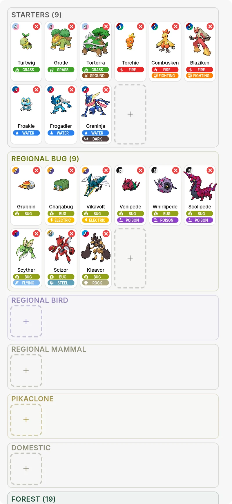
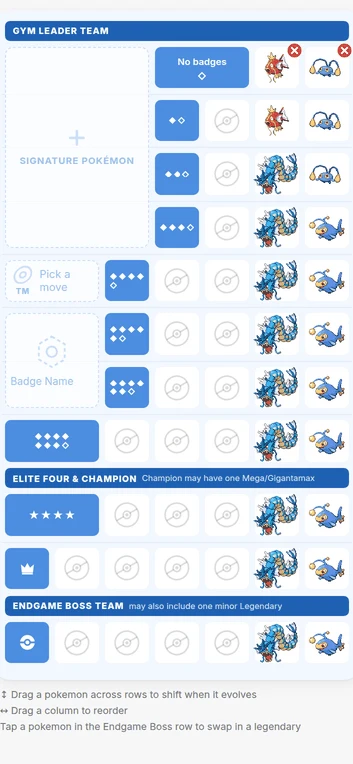
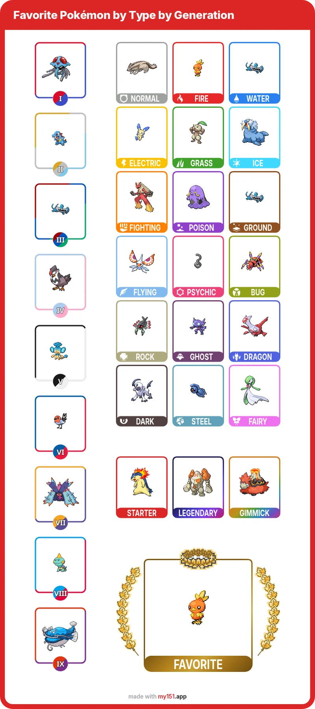

# Product and engineering examples

my151 gives Pokémon fans tools to create a regional Pokédex, a League, and a chart of favorites.
The [live product](https://my151.app) demonstrates the interactions.
This private portfolio guide connects selected examples to their implementation decisions and recorded evidence.

## Product examples

These existing homepage assets illustrate the tools.
They are prepared product examples, not fresh screenshots of every current interface.

| Dex Builder | League Builder | Favorite Picker |
| --- | --- | --- |
|  |  |  |
| [Build a personal Pokédex](https://my151.app/pokedex-builder) | [Create a League](https://my151.app/custom-gym-leader) | [Choose favorites](https://my151.app/favorite-pokemon-picker) |

The [architecture guide](architecture.md) explains the shared browser, local saves, server records, and Canvas exports behind these tools.

## Preserve selections and reject incomplete verification

The October 16 hardening work addressed two trust problems.
Invalid Dex reorders could change saved member counts.
The verification system could treat missing required coverage as a pass.
The changes preserve reorder membership and distinguish incomplete coverage from success.

The [hardening report](evidence/agent-hardening-2026-10-16/README.md) records failing checks before the fixes and passing checks afterward.
Its canonical fast run passes 782 unit, API, migration, and gate tests, plus 16 critical browser journeys.
An additional 23 focused browser cases pass on that recorded source.
Those are historical run counts, not a claim about every later revision or every browser engine.

## Make homepage content appear earlier

The October 15 homepage work changed initial content delivery and font readiness.
In its controlled laboratory comparison, complete cards appear at a median of 635 ms instead of 774 ms on the fast-mobile profile.
The slow-4G comparison records 2,312 ms instead of 2,771 ms.
The handler-readiness medians increase, although their sample ranges overlap.
Lighthouse LCP does not show a consistent improvement across profiles.

The [homepage report](handoff/homepage-early-paint-2026-10-15.md) records the profiles, source versions, repeated runs, limitations, and evidence.
These laboratory results do not establish field performance.
[Performance targets](performance.md) distinguish real-user goals from local measurements.

## Presentation and access

Use the live product, selected product images, and bounded engineering claims when presenting the project.
This guide does not grant permission to publish the private source or internal records.
The [private-source policy](../CLAUDE.md#published-license-source) and [asset provenance](credits/README.md) remain authoritative.
Historical evidence has its own [retention and archive policy](evidence-retention.md).
